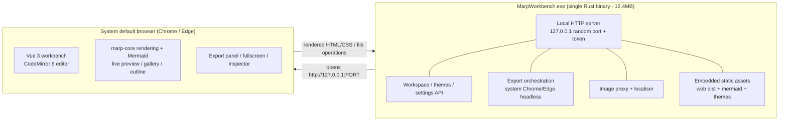

<p align="center">
  
</p>

<h1 align="center">MarpWorkbench</h1>

<p align="center">
  <b>A portable, single-file Windows <code>.exe</code> that opens a Marp workbench in your browser — write Markdown on the left, see live slides on the right, switch themes in one click, export to PPTX / PDF / HTML.</b>
</p>

<p align="center">
  <b>English</b> · <a href="README.md">简体中文</a>
</p>

<p align="center">
  <a href="https://github.com/mlwei1/MarpWorkbench/releases/latest"></a>
  
  
  
  
</p>

<p align="center">
  <b>⬇️ <a href="https://github.com/mlwei1/MarpWorkbench/releases/latest">Download the latest release</a></b>
  &nbsp;·&nbsp;
  <a href="https://github.com/mlwei1/MarpWorkbench/releases/download/v0.1.0/MarpWorkbench-v0.1.0-win-x64.exe">single .exe (12.4 MB)</a>
  &nbsp;·&nbsp;
  <a href="https://github.com/mlwei1/MarpWorkbench/releases/download/v0.1.0/MarpWorkbench-v0.1.0-win-x64.zip">zip</a>
  &nbsp;·&nbsp;
  <a href="https://github.com/mlwei1/MarpWorkbench/releases/download/v0.1.0/SHA256SUMS.txt">SHA256</a>
</p>

> **Requirements**: Windows 10/11 (64-bit); export needs the built-in Edge (or Chrome); no Node/Rust required, fully offline. If SmartScreen appears on first run, choose “More info → Run anyway”.

<p align="center">
  
  
  
  
</p>

---

## ✨ Why another Marp tool?

Marp is great, but using it from VS Code is still friction:

| Pain | VS Code + Marp | MarpWorkbench |
|---|---|---|
| Change theme | edit YAML `theme:` + hand-write CSS + `settings.json` | **one click in the theme gallery**, the whole deck restyles |
| Custom themes | create `.css`, remember `/* @theme */`, register paths | built-in **theme editor** (CSS + live preview + validation + save-as-copy) |
| Export | find a command in the palette / memorise shortcuts | top-bar **Export** → PPTX / PDF / HTML with progress |
| Images | relative paths, paste, missing files | paste/drop auto-import; background/opacity/split-ratio controls; **click image button on an existing image = edit it in place** |
| Tables | hand-write GFM | grid picker + inline cell editor + alignment |
| Properties | hand-write front-matter | right-side **property inspector** (size/page numbers/header/footer/class/background) |
| Diagrams | install plugins, configure mermaid | ` ```mermaid ` blocks render **out of the box** (bundled offline, exported as SVG) |
| Sharing | recipients must set up an environment | **single .exe**, double-click, runs offline |

Core principle: **everything you produce is standard Marp Markdown** (copy it back to VS Code / `marp-cli` any time), but every format decision is a UI you can click.

---

## 📸 Screenshots

<table>
  <tr>
    <td width="50%"></td>
    <td width="50%"></td>
  </tr>
  <tr>
    <td align="center"><sub>Four-pane layout: format toolbar / outline · slide thumbnails / editor / live preview / inspector</sub></td>
    <td align="center"><sub>Theme gallery: 12 original themes, thumbnails rendered from <em>your</em> deck</sub></td>
  </tr>
  <tr>
    <td></td>
    <td></td>
  </tr>
  <tr>
    <td align="center"><sub>Image inserter: normal / background (full, left, right with ratio) / opacity / blur / grayscale, live preview</sub></td>
    <td align="center"><sub><code>```mermaid</code> blocks render in preview, thumbnails and exports</sub></td>
  </tr>
  <tr>
    <td></td>
    <td></td>
  </tr>
  <tr>
    <td align="center"><sub>Fullscreen presentation: ← → ↑ ↓ / Space / Home / End to navigate, Esc to exit</sub></td>
    <td align="center"><sub>Theme editor: CSS with line numbers, live deck preview, <code>@theme</code> validation</sub></td>
  </tr>
</table>

<p align="center">
  
</p>
<p align="center"><sub>Outline / slide-thumbnail navigation: heading tree + page numbers + click-to-jump (virtualised for 100+ slides)</sub></p>

<p align="center">
  
</p>
<p align="center"><sub>Export: PPTX (image-based 2×, 16:9, speaker notes), PDF (vector, selectable Chinese text), single-file HTML</sub></p>

---

## 🚀 Quick start

### Option 1 — Download the prebuilt exe (recommended)

Grab the latest from [**Releases**](https://github.com/mlwei1/MarpWorkbench/releases/latest):

```
MarpWorkbench-v0.1.0-win-x64.exe     # single-file executable
MarpWorkbench-v0.1.0-win-x64.zip     # exe + README (zh/en) + LICENSE
SHA256SUMS.txt                        # checksums
```

Double-click the exe — done.

### Option 2 — Build from source

Binaries are not committed to the repository — clone and build the single-file exe:

```powershell
git clone https://github.com/mlwei1/MarpWorkbench.git
cd MarpWorkbench

# Requirements: Windows 10/11 · Node ≥ 20 · pnpm · Rust 1.95+ · Chrome or Edge installed (for export)
pnpm --dir web install
pnpm --dir web approve-builds esbuild   # pnpm 12 requires approving esbuild once

pnpm run build          # mermaid bundle → marp render bundle → web dist → Rust exe
# Output: server\target\release\MarpWorkbench.exe
```

Double-click `MarpWorkbench.exe`. It starts a local server (127.0.0.1 only, random port + one-time token), opens your default browser and drops you into the workbench. **No installer, no registry writes, uninstall = delete the folder.**

### Workflow

1. Home → “New blank deck / Sample deck”, or import an existing `.md`
2. Write Markdown on the left; preview updates on the right
3. Use the **Inspector** on the right for theme / size / page numbers / header / footer / class / background
4. Diagrams: toolbar “◈ Diagram”, or type a ` ```mermaid ` block
5. Top-bar **Export** → **PPTX (image-based) / PDF / HTML**; use **▶ Fullscreen** in the preview toolbar to present

### Keyboard shortcuts

| Shortcut | Action |
|---|---|
| `Ctrl + S` | Save (plus 800 ms debounced autosave and a 30 s forced save) |
| `Ctrl + P` | Open the export panel |
| `Ctrl + B` | Bold |
| `Ctrl + Z / Ctrl + Shift + Z` | Undo / redo |
| Fullscreen: `← → ↑ ↓` / Space / `Home` `End` | Previous/next page, next page, first/last page |
| Fullscreen: `Esc` | Exit presentation |

---

## 🧩 Features

| Area | What you get |
|---|---|
| **Editing** | CodeMirror 6, Markdown highlighting, visible `---` page breaks, outline/slide thumbnails, autosave, `rev` conflict protection |
| **Preview** | marp-core rendering in the browser, 16:9 live preview, zoom/fit, **stable in-place updates (no jump while typing)**, fullscreen presentation |
| **Themes** | 12 original themes + Marp's 3 built-ins; gallery (real deck thumbnails/categories/search/favourites/recent/↑↓/undo); import `.css`; CSS editor with live preview, `@theme` validation and save-as-copy |
| **Inspector** | Theme, size (16:9 / 4:3), page numbers (global + per-slide tri-state), header/footer (global + per-slide override), global/per-slide class, page background (fit + opacity); only touches the target field, unknown fields are preserved |
| **Images** | Paste/drop auto-import; inserter: normal image width / background full·left·right ratio 20–70% / opacity / blur / grayscale / cover·contain·fit, **live preview**; **click the image button with the cursor on an image to edit it in place** |
| **Tables** | 12×12 grid picker, inline cell editing, header/first-column bold, alignment, GFM preview |
| **Diagrams** | ` ```mermaid ` / ` ```mmd ` → SVG (flowchart / sequence / class / state / gantt / pie…), offline, lazy-loaded, graceful error fallback |
| **Legacy docs** | Remote images shown through a local proxy + one-click “download to local `assets/`” that rewrites the Markdown; exports inline them automatically |
| **Export** | PPTX (image-based, 2×, 16:9, speaker notes preserved), PDF (vector, 960×540 pt, extractable Chinese text), single-file HTML (plays offline) |
| **Presentation** | Fullscreen playback (`← → ↑ ↓` / Space / PageUp/Down / Home/End / Esc) |
| **Lightweight** | 12.4 MB single exe (mermaid + marp-core + 12 themes + frontend embedded), zero runtime dependencies, fully offline, no external requests |

---

## 🏗️ Architecture



- **Why a single Rust binary instead of Electron?** Lightweight is a hard requirement. Rust (axum + tokio + rust-embed) gives a dependency-free binary; rendering happens in the browser (same marp-core as Marp itself); export uses the Chrome/Edge already installed on the machine, so no Chromium is bundled.
- **Why exports are faithful**: PDF goes through Chromium's print pipeline (`@page 1280×720` → exactly 960×540 pt, selectable text); PPTX uses CDP native screenshots (2×) + pptxgenjs, mirroring `marp-cli --pptx`.
- **Offline**: mermaid, KaTeX fonts, themes and frontend assets are all embedded; rendering makes zero external requests (remote images either need a one-click localisation or an internet connection).

---

## 📦 Project layout

```
server/        Rust local service (static assets / workspace / themes / export / image proxy / lifecycle)
web/           Vue 3 + Vite + CodeMirror 6 frontend (marp-core rendering, mermaid, inserters, theme editor)
themes/        12 original Marp theme CSS files
scripts/       Build / smoke / E2E acceptance scripts (build:marp, build:mermaid, smoke, visual-e2e*)
docs/          Plan, API contract, acceptance reports, dev docs, research (with measurements), screenshots
spike/         Technical spikes (not shipped)
```

---

## ✅ Quality & verification

Every milestone is verified with the real exe + system Chrome (scripts under `scripts/`, no mocks):

```powershell
pnpm run verify:smoke    # API smoke: start / workspace / themes / PDF / PPTX capture / shutdown — 12 checks
pnpm run verify:visual   # core flow: edit / themes / real PPTX export — 13 checks
pnpm run verify:m2       # inspector / outline+thumbnails / image+table inserters / theme import+editor — 26 checks
pnpm run verify:m3       # Mermaid / remote-image localisation / in-place image editing / PDF with diagrams — 21 checks
pnpm run verify:m3fix    # no preview jumping while typing + fullscreen arrow-key navigation — 14 checks
```

Latest run: **all green** (12/12 · 13/13 · 26/26 · 21/21 · 14/14), 12/12 themes rendered, zero external requests, zero JavaScript errors.

---

## 🗺️ Roadmap

- [x] M1 Skeleton: Rust single-file service + Vue editor/preview + theme switching + PDF / PPTX / HTML export
- [x] M2 Usability: 12 themes / theme import & editor / inspector / outline & thumbnails / image & table inserters / format toolbar
- [x] M3 Enhancements: Mermaid diagrams / legacy remote images / in-place image editing
- [x] M3.1 Experience: stable preview while typing + fullscreen presentation
- [ ] M4 Release: starter templates / slide add-duplicate-delete / “open containing folder” after export / packaging & GitHub Release

---

## 📚 Documentation

| Document | Content |
|---|---|
| [docs/PROJECT_PLAN.md](docs/PROJECT_PLAN.md) | Plan: product definition, scope, architecture, milestones, risks |
| [docs/M3_1_ACCEPTANCE.md](docs/M3_1_ACCEPTANCE.md) | M3.1 acceptance: preview stability + fullscreen |
| [docs/M3_ACCEPTANCE.md](docs/M3_ACCEPTANCE.md) | M3 acceptance: Mermaid / remote images / in-place image editing |
| [docs/M2_ACCEPTANCE.md](docs/M2_ACCEPTANCE.md) | M2 acceptance: themes / inspector / outline / inserters |
| [docs/API_CONTRACT.md](docs/API_CONTRACT.md) | Frontend ↔ backend API contract and engineering conventions |
| [docs/dev/](docs/dev/) | server / frontend / themes / export / outline / mermaid developer notes |
| [docs/research/](docs/research/) | Marp stack, runtime selection, UX research (with measurements) |

---

## 🙏 Acknowledgements

- [Marp](https://marp.app/) / [Marp Core](https://github.com/marp-team/marp-core) / [Marpit](https://marpit.marp.app/) — rendering and theming
- [Mermaid](https://mermaid.js.org/) — diagrams
- [CodeMirror](https://codemirror.net/) · [Vue](https://vuejs.org/) · [Vite](https://vite.dev/)
- [PptxGenJS](https://github.com/gitbrent/PptxGenJS) — image-based PPTX assembly

---

## 📄 License

[MIT](LICENSE) © 2026 MarpWorkbench contributors

> This project is not affiliated with the Marp team; “Marp” is a trademark of its respective owners. All bundled themes are original.
