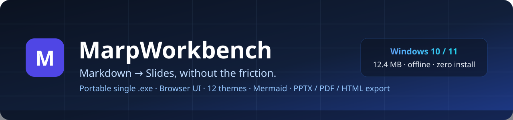
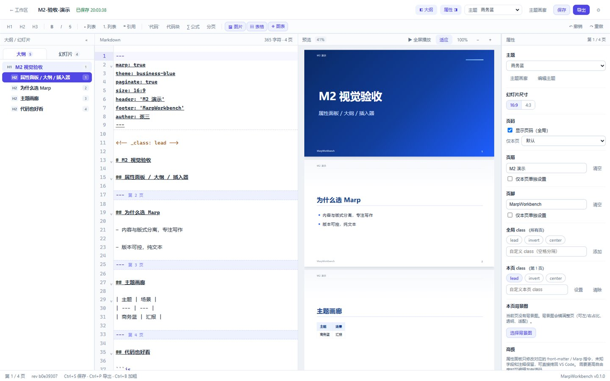
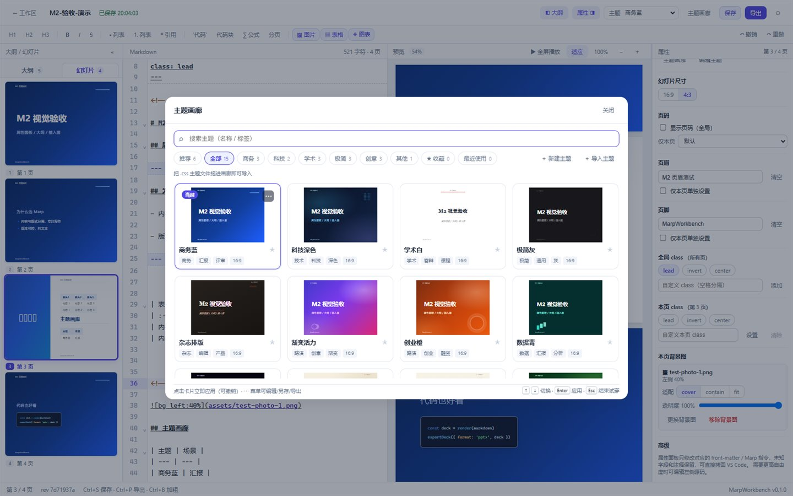
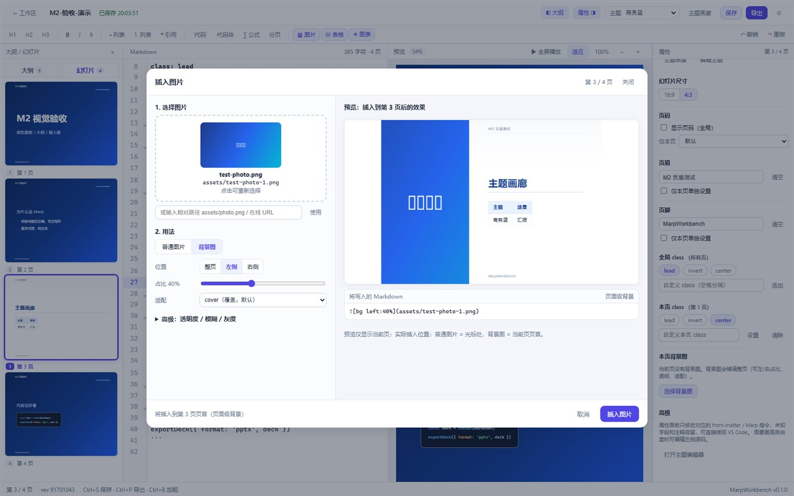
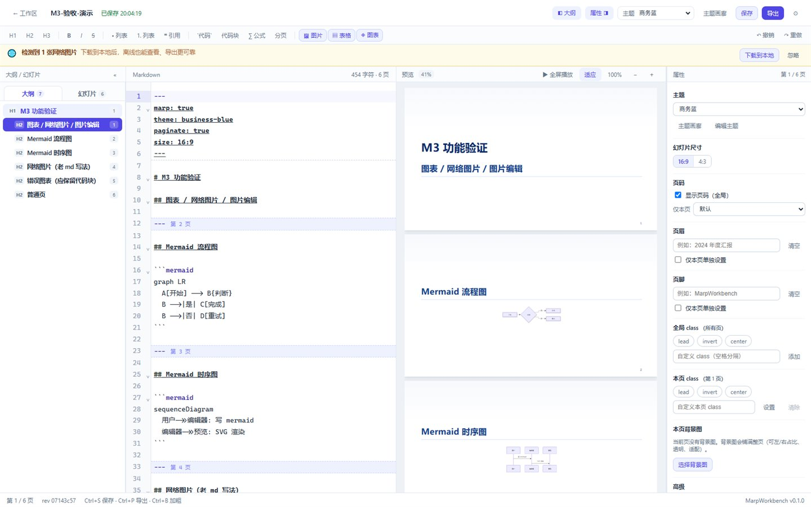
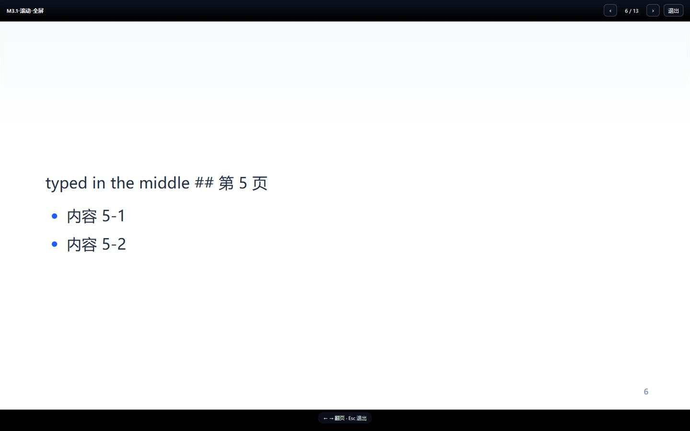
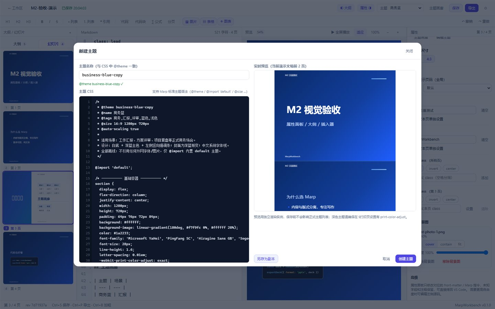
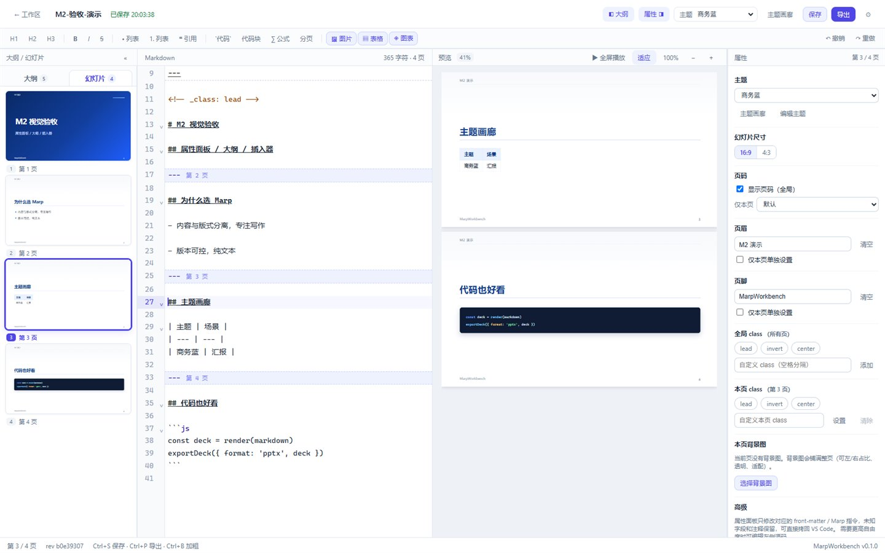
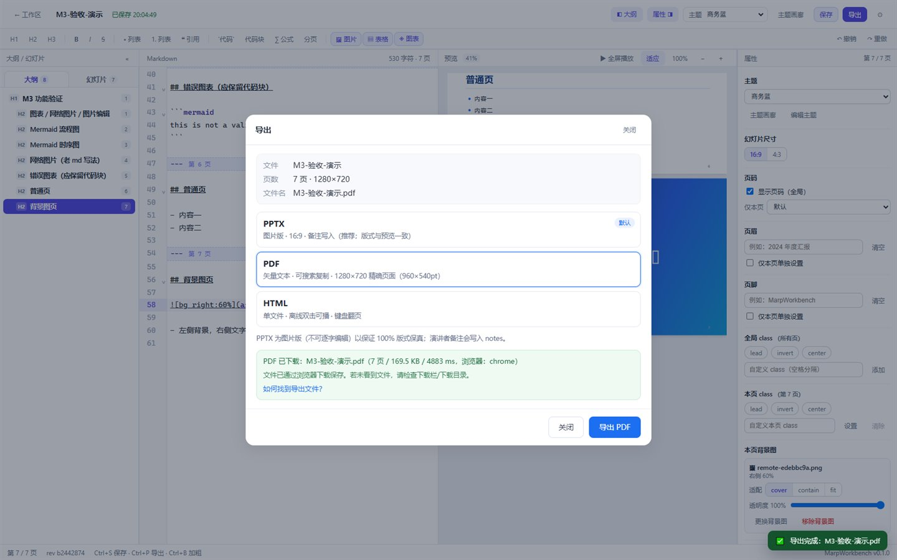
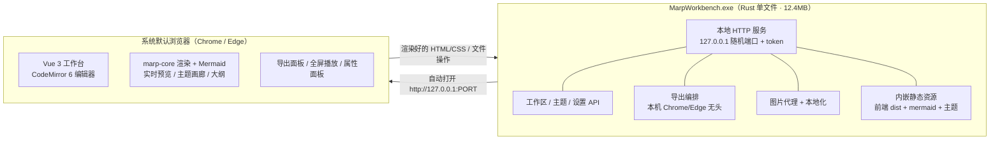

<p align="center">
  
</p>

<h1 align="center">MarpWorkbench · Marp 工作台</h1>

<p align="center">
  <b>一个绿色便携的 Windows 单文件 <code>.exe</code>：双击后在浏览器里打开 Marp 工作台，左边写 Markdown、右边实时预览、点一下换主题、一键导出 PPTX / PDF / HTML。</b>
</p>

<p align="center">
  <a href="README.en.md">English</a> · <b>简体中文</b>
</p>

<p align="center">
  <a href="https://github.com/mlwei1/MarpWorkbench/releases/latest"></a>
  
  
  
  
</p>

<p align="center">
  <b>⬇️ <a href="https://github.com/mlwei1/MarpWorkbench/releases/latest">下载最新版 / Download latest release</a></b>
  &nbsp;·&nbsp;
  <a href="https://github.com/mlwei1/MarpWorkbench/releases/download/v0.1.0/MarpWorkbench-v0.1.0-win-x64.exe">单文件 exe（12.4MB）</a>
  &nbsp;·&nbsp;
  <a href="https://github.com/mlwei1/MarpWorkbench/releases/download/v0.1.0/MarpWorkbench-v0.1.0-win-x64.zip">zip</a>
  &nbsp;·&nbsp;
  <a href="https://github.com/mlwei1/MarpWorkbench/releases/download/v0.1.0/SHA256SUMS.txt">SHA256</a>
</p>

> **使用要求**：Windows 10/11（64 位）；导出需要系统自带的 Edge（或 Chrome）；无需 Node/Rust，离线可用。首次运行如遇 SmartScreen，点「更多信息 → 仍要运行」。

<p align="center">
  
  
  
  
</p>

---

## ✨ 为什么做它

Marp 很好用，但在 VS Code 里用起来总差一口气：

| 痛点 | VS Code + Marp | MarpWorkbench |
|---|---|---|
| 换主题 | 改 YAML `theme:` + 手写 CSS + 改 `settings.json` | **主题画廊点一下**，全 deck 立即换装 |
| 自定义主题 | 新建 `.css`、记 `/* @theme */` 语法、注册路径 | 内置**主题编辑器**（CSS + 实时预览 + 校验 + 另存副本） |
| 导出 | 命令面板找命令 / 记快捷键 | 顶部「导出」→ PPTX / PDF / HTML，进度可见 |
| 图片 | 相对路径、粘图、丢图 | 粘贴/拖拽自动入库；背景图/透明度/左右占比可视化；**光标图片上点按钮 = 原位编辑** |
| 表格 | 手写 GFM | 网格选行列 + 单元格编辑 + 对齐 |
| 属性 | 手写 front-matter | 右侧**属性面板**点选（尺寸/页码/页眉/页脚/class/背景图） |
| 图表 | 装插件、配 mermaid | ` ```mermaid ` 代码块**直接渲染**（离线内置、导出为 SVG） |
| 分发 | 对方还得配环境 | **单文件 exe**，双击即用，离线运行 |

核心原则：**产出的永远是标准 Marp Markdown**（随时能拷回 VS Code / `marp-cli`），但把「格式决策层」全部做成了可以点的 GUI。

---

## 📸 界面预览

<table>
  <tr>
    <td width="50%"></td>
    <td width="50%"></td>
  </tr>
  <tr>
    <td align="center"><sub>四区布局：格式工具栏 / 大纲·缩略图 / 编辑 / 实时预览 / 属性面板</sub></td>
    <td align="center"><sub>主题画廊：12 套原创主题，缩略图用你当前的 deck 真实渲染</sub></td>
  </tr>
  <tr>
    <td></td>
    <td></td>
  </tr>
  <tr>
    <td align="center"><sub>图片插入器：普通图 / 背景图整页·左·右占比 / 透明度 / 模糊灰度，对话框内实时预览</sub></td>
    <td align="center"><sub><code>```mermaid</code> 代码块直接渲染（预览 / 缩略图 / 导出全支持）</sub></td>
  </tr>
  <tr>
    <td></td>
    <td></td>
  </tr>
  <tr>
    <td align="center"><sub>全屏播放：← → ↑ ↓ / 空格 / Home / End 翻页，Esc 退出</sub></td>
    <td align="center"><sub>主题编辑器：CSS 行号编辑 + 当前 deck 实时预览 + <code>@theme</code> 校验</sub></td>
  </tr>
</table>

<p align="center">
  
</p>
<p align="center"><sub>大纲 / 幻灯片缩略图导航：标题层级树 + 页码 + 点击跳页（100 页虚拟滚动不卡）</sub></p>

<p align="center">
  
</p>
<p align="center"><sub>导出：PPTX（图片版 2x，16:9，备注写入 notes）/ PDF（矢量、中文可提取）/ HTML 单文件</sub></p>

---

## 🚀 快速开始

### 方式一：下载现成 exe（推荐）

到 [**Releases**](https://github.com/mlwei1/MarpWorkbench/releases/latest) 下载 `MarpWorkbench-*.exe`（单文件，约 12.4MB），双击即用：

```
MarpWorkbench-v0.1.0-win-x64.exe     # 单文件主程序
MarpWorkbench-v0.1.0-win-x64.zip     # exe + 中英文 README + LICENSE
SHA256SUMS.txt                        # 校验值
```

### 方式二：从源码构建

仓库不提交二进制文件。克隆后本地构建即可得到**单文件 exe**：

```powershell
git clone https://github.com/mlwei1/MarpWorkbench.git
cd MarpWorkbench

# 环境：Windows 10/11 · Node ≥ 20 · pnpm · Rust 1.95+ · 本机装有 Chrome 或 Edge（导出用）
pnpm --dir web install
pnpm --dir web approve-builds esbuild   # pnpm 12 需显式批准一次 esbuild 安装脚本

pnpm run build          # 依次构建 mermaid 包 → marp 渲染包 → 前端 → Rust exe
# 产物：server\target\release\MarpWorkbench.exe
```

双击 `MarpWorkbench.exe`：启动本地服务（仅监听 `127.0.0.1`，随机端口 + 一次性 token）→ 自动打开默认浏览器 → 进入工作台。**无安装、不写注册表、删目录即卸载。**

### 使用流程

1. 首页「＋ 新建空白 / 示例演示」或导入 `.md`
2. 左边写 Markdown，右边实时预览（滚轮/光标联动）
3. 右侧「属性」点选主题 / 尺寸 / 页码 / 页眉页脚 / class / 背景图
4. 需要图表：工具栏「◈ 图表」或直接写 ` ```mermaid `
5. 顶部「导出」→ **PPTX（图片版）/ PDF / HTML**；预览工具栏「▶ 全屏播放」演示

### 常用快捷键

| 快捷键 | 功能 |
|---|---|
| `Ctrl + S` | 保存（另有 800ms 防抖自动保存 + 30s 强制保存） |
| `Ctrl + P` | 打开导出面板 |
| `Ctrl + B` | 加粗 |
| `Ctrl + Z / Ctrl + Shift + Z` | 撤销 / 重做 |
| 全屏播放中 `← → ↑ ↓` / 空格 / `Home` `End` | 翻页 / 下一页 / 首页末页 |
| 全屏播放中 `Esc` | 退出播放 |

---

## 🧩 功能一览

| 模块 | 能力 |
|---|---|
| **编辑** | CodeMirror 6、Markdown 高亮、`---` 分页线可视化、大纲/缩略图、自动保存、`rev` 冲突保护 |
| **预览** | marp-core 浏览器端渲染、16:9 实时预览、缩放/适应、**稳定原位更新（打字不闪跳）**、全屏播放 |
| **主题** | 12 套原创主题 + Marp 原生 3 套；画廊（真实 deck 缩略图/分类/搜索/收藏/最近/↑↓/撤销）；导入 `.css`；CSS 编辑器（实时预览 + `@theme` 校验 + 另存副本） |
| **属性** | 主题、尺寸（16:9 / 4:3）、页码（全局 + 本页三态）、页眉/页脚（全局 + 单页覆盖）、全局/本页 class、本页背景图（适配 + 透明度）；只改目标字段，未知字段保留 |
| **图片** | 粘贴/拖拽自动入库；插入器：普通图宽度 / 背景图整页·左·右占比 20–70% / opacity / blur / grayscale / cover·contain·fit，**实时预览**；**光标在已有图片上点图片按钮 = 原位编辑** |
| **表格** | 12×12 网格选行列、单元格直接编辑、表头/首列加粗/对齐、GFM 预览 |
| **图表** | ` ```mermaid ` / ` ```mmd ` 渲染为 SVG（flowchart / sequence / class / state / gantt / pie…），离线、懒加载、错误块降级 |
| **老文档兼容** | 网络图片经本地代理显示 + 一键下载到 `assets/` 并重写 Markdown；导出自动内联 |
| **导出** | PPTX（图片版 2x，16:9，备注写入 notes）、PDF（矢量 960×540pt，中文可提取）、HTML 单文件（离线可播） |
| **演示** | 全屏播放（`← → ↑ ↓` / Space / PageUp/Down / Home/End / Esc） |
| **轻量** | 单文件 12.4MB（内嵌 mermaid + marp-core + 12 主题 + 前端），零运行时依赖、离线可用、0 外网请求 |

---

## 🏗️ 技术架构



- **为什么是 Rust 单文件而不是 Electron**：目标是最轻量。Rust（axum + tokio + rust-embed）单文件零依赖；渲染放在浏览器端（与 Marp 官方同源）；导出借本机已装的 Chrome/Edge 无头打印，不用打包 Chromium。
- **导出为什么保真**：PDF 走 Chromium 打印管线（`@page 1280×720`，精确 960×540pt、矢量可复制）；PPTX 走 CDP 原生截图 2x + pptxgenjs（与 `marp-cli --pptx` 同思路）。
- **离线**：mermaid / KaTeX 字体 / 主题 / 前端资源全部内嵌；任何渲染路径 0 外网请求（网络图片需你主动下载或联网预览）。

---

## 📦 项目结构

```
server/        Rust 本地服务（静态资源 / 工作区 / 主题 / 导出 / 图片代理 / 生命周期）
web/           Vue 3 + Vite + CodeMirror 6 前端（marp-core 浏览器渲染、mermaid、插入器、主题编辑器）
themes/        12 套原创 Marp 主题 CSS
scripts/       构建 / 冒烟 / E2E 验收脚本（build:marp、build:mermaid、smoke、visual-e2e*）
docs/          项目计划、接口契约、验收报告、开发文档、调研（含实测数据）、README 截图
spike/         技术验证工程（不进入发布包）
```

---

## ✅ 质量与验证

每轮功能都有真实 exe + 系统 Chrome 的自动化验收（脚本在 `scripts/`，不依赖 mock）：

```powershell
pnpm run verify:smoke    # API 冒烟（启动/工作区/主题/PDF/PPTX 截图/退出）12 项
pnpm run verify:visual   # 基础流程：编辑 / 主题 / 真实导出 PPTX 13 项
pnpm run verify:m2       # 属性面板 / 大纲缩略图 / 图片表格插入器 / 主题导入编辑器 26 项
pnpm run verify:m3       # Mermaid / 网络图片本地化 / 图片原位编辑 / 含图 PDF 21 项
pnpm run verify:m3fix    # 打字时预览不跳动 + 全屏播放方向键翻页 14 项
```

最近一轮结果：**全部通过**（12/12 · 13/13 · 26/26 · 21/21 · 14/14）；主题渲染 12/12；零外网请求、零 JavaScript 错误。

---

## 🗺️ 路线图

- [x] M1 骨架：Rust 单文件服务 + Vue 编辑器/预览 + 主题切换 + PDF / PPTX / HTML 导出
- [x] M2 易用性：12 套主题 / 主题导入与编辑器 / 属性面板 / 大纲缩略图 / 图片表格插入器 / 格式工具栏
- [x] M3 增强：Mermaid 图表 / 老 md 网络图片兼容 / 图片原位编辑
- [x] M3.1 体验：预览滚动稳定 + 全屏播放
- [ ] M4 发布：新手模板 / 幻灯片增删拖拽 / 导出后打开文件夹 / 打包与 GitHub Release

---

## 📚 文档

| 文档 | 内容 |
|---|---|
| [docs/PROJECT_PLAN.md](docs/PROJECT_PLAN.md) | 项目计划：产品定义、范围、架构、里程碑、风险 |
| [docs/M3_1_ACCEPTANCE.md](docs/M3_1_ACCEPTANCE.md) | M3.1 验收：预览滚动修复 / 全屏播放 |
| [docs/M3_ACCEPTANCE.md](docs/M3_ACCEPTANCE.md) | M3 验收：Mermaid / 网络图片 / 图片原位编辑 |
| [docs/M2_ACCEPTANCE.md](docs/M2_ACCEPTANCE.md) | M2 验收：主题 / 属性面板 / 大纲 / 插入器 |
| [docs/API_CONTRACT.md](docs/API_CONTRACT.md) | 前后端接口契约与工程约定 |
| [docs/dev/](docs/dev/) | server / frontend / themes / export / outline / mermaid 开发说明 |
| [docs/research/](docs/research/) | Marp 技术栈、运行时选型、UX 调研（含实测数据） |

---

## 🙏 致谢

- [Marp](https://marp.app/) / [Marp Core](https://github.com/marp-team/marp-core) / [Marpit](https://marpit.marp.app/) — 渲染与主题体系
- [Mermaid](https://mermaid.js.org/) — 图表
- [CodeMirror](https://codemirror.net/) · [Vue](https://vuejs.org/) · [Vite](https://vite.dev/)
- [PptxGenJS](https://github.com/gitbrent/PptxGenJS) — PPTX 图片版组装

---

## 📄 License

[MIT](LICENSE) © 2026 MarpWorkbench contributors

> 本项目与 Marp 官方无隶属关系；"Marp" 是其各自权利人的商标。内置主题均为原创。
