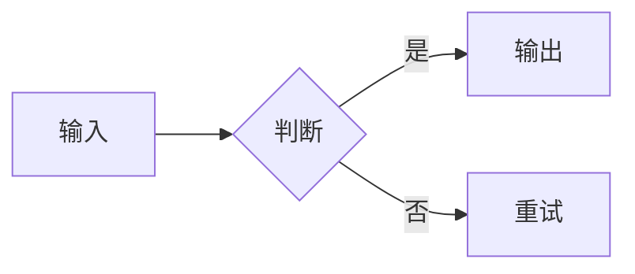
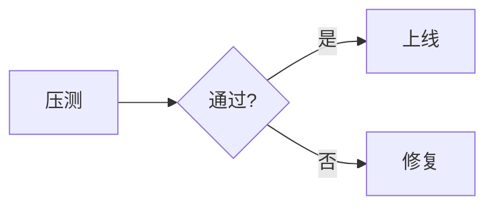

# AI 写作规范（MarpWorkbench 专用）

> 给 AI（或人）看的 Marp Markdown 输出规范。按本文件生成的 `.md` 可直接导入 **MarpWorkbench**：预览、换主题、全屏播放、导出 PPTX（图片版/可编辑版）/PDF/HTML。
> 目标：**任何 AI 只要读到本文件，就能稳定写出不跑偏的 Marp deck。**

---

## 1. 输出契约（必须遵守）

1. 只输出 **一个完整的 `.md` 文件内容**；不要用 ``` 包裹整篇（除非用户明确要求）。
2. 使用标准 **Marp Markdown**（不是 PowerPoint、不是 HTML 幻灯片、不是 reveal.js）。
3. 用 `---`（单独一行）分页；**第一页之前**放 YAML front-matter。
4. 文件编码 UTF-8；中文内容直接写中文，不要转义成 `\uXXXX`。
5. 不要输出解释、markdown 外的寒暄；如需要给建议，放在文件外由用户决定。
6. 图片只用 `https://` 远程地址（应用会自动代理/可一键本地化）；不要写本地磁盘路径。
7. 不确定的 Marp 指令不要写；**本文件没有列出的语法不要用**。

---

## 2. 文件骨架

```markdown
---
marp: true
theme: business-blue
paginate: true
size: 16:9
header: 'MarpWorkbench'
footer: '2026'
---

<!-- _class: lead -->

# 演示标题

## 副标题 / 一句话说明

---

## 第二页标题

- 要点一
- 要点二
- 要点三

<!-- 演讲者备注：这里写这一页的口播内容，不会出现在幻灯片上 -->
```

- `theme`：见 §3；`size`：`16:9`（默认）或 `4:3`。
- `paginate: true` 显示页码；`header`/`footer` 为全局页眉/页脚。
- 每一页建议有一个 `## 标题`；封面页可用 `#` + `_class: lead`。
- 备注用 `<!-- 文字 -->`；**页面指令**用 `<!-- _class: ... -->` 这类下划线开头形式（不会当备注显示）。

---

## 3. 主题（theme 只能填这些）

| 名称 | 风格 | 适合 |
|---|---|---|
| `business-blue` | 白底深蓝、商务 | 工作汇报、方案评审（默认推荐） |
| `tech-dark` | 深海蓝底、青色 | 技术分享、架构评审 |
| `academic-white` | 纯白衬线、学术 | 论文答辩、课程讲义 |
| `minimal-gray`、`paper-warm` | 极简 / 暖纸 | 长文阅读型 |
| `data-teal` | 数据青、表格友好 | 数据汇报 |
| `magazine`、`gradient-vivid` | 杂志排版 / 紫粉渐变 | 产品发布、创意提案 |
| `startup-orange` | 创业橙 | 路演、BP |
| `dark-neon` | 近黑 + 霓虹 | 发布会、品牌活动 |
| `chinese-ink`、`nature-green` | 中国风水墨 / 自然绿 | 文化、教育、环保 |
| `default` / `gaia` / `uncover` | Marp 原生内置 | 通用兜底 |

> 主题样式由应用内置；**不要**在 Markdown 里写自定义 CSS，也不要依赖主题没有的 class。

## 4. 常用页面 class

| 写法 | 作用 |
|---|---|
| `<!-- _class: lead -->` | 封面/章节页大字版式（主题支持时） |
| `<!-- _class: center -->` | 内容居中 |
| `<!-- _class: invert -->` | 反色页（深色主题常用，浅色主题慎用） |

多 class 用空格：`<!-- _class: lead center -->`。

## 5. 常用元素

```markdown
## 标题

- 无序要点
- 第二点
  - 二级要点（最多两层）

1. 有序步骤
2. 第二步

> 引用 / 金句

**加粗**、*斜体*、`行内代码`、~~删除线~~

| 指标 | 数值 | 说明 |
| --- | --- | --- |
| 收入 | 1200 万 | 同比 +18% |

```js
const hello = 'world'
```

数学：行内 $E=mc^2$，块级：

$$
\sum_{i=1}^{n} x_i
$$
```

排版建议（让 deck 好看且不溢出）：
- 每页最多 **1 个标题 + 5–6 条要点**；每条不超过约 **40 个中文字**。
- 一页只讲一个观点；标题用「结论」而不是「背景」。
- 表格不超过 5 列；宽表拆两页。
- 代码块每行 ≤ 80 字符，页内代码不超过 15 行。
- 备注里写口播稿，每页 2–4 句。

## 6. 图片

```markdown
        <!-- 普通图片，宽度 640px -->
                                      <!-- 应用会换算成 px，建议直接写 px -->
                  <!-- 整页背景 -->
         <!-- 左侧 40% 背景，右侧文字 -->


## 背景图页

- 文字放在右侧
```

- 宽度用 **px**（如 `w:640px`）；不要用百分比（应用会换算但 AI 直接写 px 最稳）。
- 背景图比例建议 16:9 或竖图（左/右分栏时竖图更合适）。
- **只使用 http(s) 图片 URL**；不要写 `assets/xxx.png` 等本地路径。

## 7. Mermaid 图（重要）

````markdown

````

- 支持的图类型：`graph`/`flowchart`、`sequenceDiagram`、`classDiagram`、`stateDiagram-v2`、`erDiagram`、`gantt`、`pie`、`mindmap`、`timeline`、`journey`、`quadrantChart`、`xychart-beta`、`sankey-beta`、`radar-beta`、`treemap-beta`、`block-beta`、`gitGraph`、`C4Context`、`kanban`。
- 常用 PPT 图表优先：象限图（优先级/定位）、柱状/折线图（趋势）、桑基图（流量/转化）、雷达图（能力对比）、树图（构成）、看板（项目状态）；技术分享可用 Git 图、C4 上下文图、块图。
- 注意：`sankey-beta` 的节点名暂只支持英文（mermaid v12 限制），`xychart-beta` 的中文轴标签要用引号。
- 可选尺寸指令（代码块第一行）：`%% mwb-size: s | m | l | xl | 70% | 900px`；不写则默认铺满内容宽度。
- 图不要太大：流程图 ≤ 12 个节点；时序图 ≤ 5 个参与者、≤ 12 条消息；甘特图 ≤ 8 行任务。
- 节点文字用中文短词（≤ 8 字）；不要在图里塞长句。
- 一页最多 1 张图；图 + 3 条要点即可。

## 8. 页面结构模板（推荐 10–15 页）

1. 封面：标题 + 副标题 + 日期/汇报人（`_class: lead`）
2. 目录/结论先行：3–5 个要点
3. 背景/问题：为什么做
4. 方案/做法：分 2–3 页，每页一个子主题
5. 数据/证据：表格或图表 1–2 页
6. 风险/取舍：一页
7. 计划/里程碑：时间线或列表
8. 结尾：结论 + 下一步 + 联系方式

每页备注写 2–4 句口播稿。

## 9. 完整最小示例

```markdown
---
marp: true
theme: business-blue
paginate: true
size: 16:9
header: '产品周报'
footer: '2026-11'
---

<!-- _class: lead -->

# 产品周报

## 2026 年 11 月 · 第 4 周

---

## 本周结论

- 新增用户 1.2 万，环比 +18%
- 核心流程转化率 42%，提升 3pct
- 下周重点：支付链路压测

<!-- 本周整体符合预期，重点讲增长来源和下周风险。 -->

---

## 增长来自哪里

| 渠道 | 新增 | 占比 |
| --- | --- | --- |
| 自然增长 | 6800 | 57% |
| 投放 | 4200 | 35% |
| 其他 | 1000 | 8% |

---

## 下一步

1. 支付链路压测（周三）
2. 投放素材 A/B（周五）
3. 下周一复盘


```

## 10. 自检清单（输出前逐条检查）

- [ ] 有 YAML front-matter，且第一行是 `---`
- [ ] `theme` 在 §3 列表中；`size` 是 `16:9`/`4:3`
- [ ] 每页之间用单独一行 `---` 分隔，没有连续两个分隔线造成空页
- [ ] 每页有标题；单页要点 ≤ 6 条、每条约 ≤ 40 字
- [ ] 图片都是 `https://` 开头；宽度用 px
- [ ] Mermaid 代码块围栏闭合；类型在支持列表内；图不过大
- [ ] 备注用 `<!-- ... -->`，页面指令用 `<!-- _class: ... -->`
- [ ] 文件末尾没有多余解释文字

## 11. 生成后直接用 CLI 做 PPT

保存为 `deck.md` 后（MarpWorkbench v0.4.0+）：

```powershell
MarpWorkbench.exe --export .\deck.md --format pptx-editable --out .\deck.pptx
```

- `--format`：`pptx`（图片版，默认）/ `pptx-editable`（文字表格可编辑）/ `pdf` / `html`
- 成功时 stdout 最后一行是 JSON；失败退出码 1 并输出中文错误
- 详细参数、AI 工作流与实测见 `docs/CLI.md`

