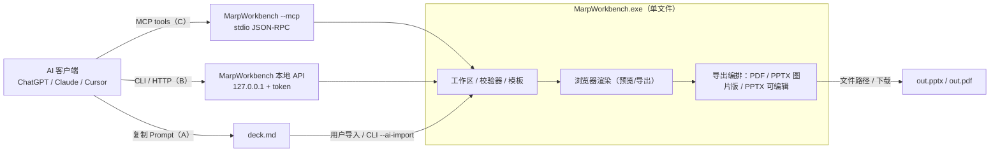

# M5 计划：Mermaid 尺寸/示例 + 让 AI 直接产出 PPT

> 状态：**M5.0 已完成（2026-11-23 验收通过）；M5.1 AI 集成待确认** ｜ 用户需求（原话）：
> 1. "添加一个 mermaid 添加图大小设置的选项，现在的图太小了，如果难度太大的话就渲染的大一点。"
> 2. "添加 mermaid 图时，各个类型的图加示例，方便用户编辑。"
> 3. "方便 ai 直接写这个 md，然后给这个项目做 ppt，先做一个计划，我的想法是 1 给 ai 这个软件的接口，2 或者输出一个说明文档，让 ai 直接根据文档输出，3. 也可以两者并行。"
>
> 本文件 = **M5.0（已完成，Mermaid 尺寸/示例）+ M5.1（AI 集成，待你确认后实施）** 的整体计划。
> M5.0 实现契约：`docs/UI_CONTRACT_M5_MERMAID.md`；验收报告：`docs/M5_0_ACCEPTANCE.md`。
> AI 文档轨已交付：`docs/AI_WRITING_GUIDE.md`、`docs/AI_PROMPT.md`（现在即可复制 Prompt 给任意 AI 使用）。

---

## 0. 结论先行（给你做决定）

| 你的想法 | 建议 | 原因 |
|---|---|---|
| ① 给 AI 软件的"接口" | ✅ 做，分两步：**先本地 HTTP/CLI**（AI 工具都能调），再 **MCP Server**（Claude Desktop / Cursor 原生集成，体验最好） | 接口能真正"AI 写完直接导出 PPT"，不依赖人手动点 |
| ② 输出说明文档让 AI 按文档写 | ✅ **先做、马上可用**（本批已产出 `docs/AI_WRITING_GUIDE.md` + `docs/AI_PROMPT.md`） | 零风险、覆盖所有 AI 客户端；文档管"写对"，接口管"自动导出" |
| ③ 两者并行 | ✅ **推荐**：文档轨（0.5–1 天）+ 接口轨（CLI/HTTP 2–3 天 + MCP 2–3 天）并行推进 | 两者互补：文档保证 AI 不写错语法；接口保证一键成片 |

**推荐排期**：先交付文档+应用内 AI 使用入口（本周可完成）→ 同时做 CLI/HTTP 导出 → 再做 MCP。MCP 完成后，Claude/Cursor 里说一句"用 MarpWorkbench 做一份 Q4 汇报 PPT"就能自动建 deck、导出、打开文件夹。

---

## 1. M5.0（本批）：Mermaid 图太小 + 类型示例

### 1.1 问题

- 旧渲染保留 mermaid 的"自然宽度"上限：小图（2 节点流程图）只显示 ~300px，投影上字太小；
- 生成图表只能用工具栏简单模板，用户不知道 mermaid 各种图怎么写；
- 已有图无法就地改尺寸，只能改 markdown。

### 1.2 方案（已实现，契约见 `UI_CONTRACT_M5_MERMAID.md`）

1. **默认放大**：取消自然宽度上限 → `width:100%; height:auto; max-width:100%; max-height:560px`，小图自动铺满内容宽度（矢量放大不糊）。
2. **尺寸选项**：Mermaid 代码块第一行支持注释指令：
   `%% mwb-size: auto | s | m | l | xl | 70% | 900px`
   → 渲染时映射到 max-width/max-height；指令保留在 Markdown 里，可反复编辑。
3. **示例库 + 插入/编辑对话框**：工具栏「◈ 图表」打开对话框：
   - 10 类图表（流程图/时序图/类图/状态图/ER/甘特/饼图/思维导图/时间线/用户旅程），每类带**中文示例代码**；
   - 中间直接改代码，右侧**实时预览**；
   - 尺寸下拉（自动/小/中/大/超大/自定义 %）；
   - 光标在已有图表内点击 → **编辑模式**，原位替换（不新增块）。
4. 验收：`pnpm run verify:mermaid-ui`（真实 exe + Chrome，插入/编辑/尺寸生效/10 类预览）；M3/M4 回归全绿。

### 1.3 交付物

`web/src/mermaid/size.ts`、`replace.ts`/`index.ts` 改造、`MermaidInsertDialog.vue`、`mermaidBlock.ts`、编辑器 `replaceRange`、M5 验收脚本、`docs/dev/mermaid.md`、`docs/dev/frontend.md`。

---

## 2. M5.1：让 AI 写 Markdown 并直接产出 PPT

### 2.1 目标与非目标

**目标**
- 任何 AI（ChatGPT / Claude / DeepSeek / Cursor / Cline…）按文档产出的 `.md` 能被本应用**100% 打开、预览、导出**，不踩语法坑。
- AI 工具能通过**本地接口**直接完成：建 deck → 写入 Markdown → 可选导出 PPTX/PDF → 返回文件路径。
- 全离线：不调用云端模型、不上传用户内容；接口只监听本机。

**非目标**
- 不做云端 AI 服务/账号体系；
- 不做"AI 生成图片"（图片仍用远程 URL 或用户素材）；
- 不做自动更新/云同步；
- 不改变"产出标准 Marp Markdown"这一核心约定。

### 2.2 用户场景

| 场景 | 路径 |
|---|---|
| 用 ChatGPT 写稿 | 复制 `AI_PROMPT.md` → 生成 md → 导入 MarpWorkbench → 微调主题 → 导出 |
| 用 Cursor/Claude 写代码式生成 | 在 IDE 里让 AI 按 `AI_WRITING_GUIDE.md` 写 `deck.md` → 运行 `MarpWorkbench.exe --ai-export deck.md --format pptx-editable` |
| 用 Claude Desktop / Cursor Agent | 通过 MCP：AI 直接调用 `create_deck`/`update_deck`/`export_deck`，无需离开对话 |
| 已有材料整理 | 把材料+Prompt 给 AI → md → 导入；或 MCP 的 `update_deck` 迭代 |

### 2.3 三条路线对比

| 路线 | 交付物 | 覆盖 AI | 开发量 | 风险 | 何时做 |
|---|---|---|---|---|---|
| **A. 文档 + Prompt** | `AI_WRITING_GUIDE.md`、`AI_PROMPT.md`、示例 deck、应用内「AI 使用说明/复制 Prompt」入口 | 所有 AI（手动复制） | **S（0.5–1 天）** | 低：AI 仍可能语法偏差，需要校验 | **先做（本批已产出文档，入口待做）** |
| **B. 本地 HTTP API + CLI** | `/api/ai/*`、`MarpWorkbench.exe --ai-import/--ai-export`、校验器 | 能执行命令/HTTP 的 AI（Cursor、脚本、Agent） | **M（2–3 天）** | 中：需复用无头浏览器做导出编排 | 第二优先 |
| **C. MCP Server** | `MarpWorkbench.exe --mcp`（stdio JSON-RPC），工具：建/写/校验/导出/主题 | Claude Desktop、Cursor、Cline、Windsurf 等 MCP 客户端 | **M–L（2–3 天）** | 中：MCP 协议实现 + 导出编排；无 Node 依赖需内嵌 Rust | 第三优先（体验最佳） |

> 推荐 **A 先落地 + B/C 并行设计**；B 与 C 共用同一套"导出编排"和"校验器"，C 的 MCP 工具就是 B 的 HTTP/CLI 能力的薄封装。

### 2.4 总体架构



### 2.5 分阶段交付

#### 阶段 A：AI 写作规范 + Prompt（0.5–1 天；本批文档已产出）

- [x] `docs/AI_WRITING_GUIDE.md`：AI 专用规范（front-matter、主题列表、class、图片、Mermaid 尺寸、备注、页结构、自检清单）
- [x] `docs/AI_PROMPT.md`：4 个可直接复制的 Prompt 模板（一句话生成/材料整理/修改/变量清单）
- [ ] 应用内入口：帮助菜单「AI 写作指南」弹窗 → 展示指南摘要 + 「复制 Prompt」按钮 + 「粘贴 AI 生成的 Markdown 新建 deck」
- [ ] `scripts/validate-deck.mjs`：校验 front-matter、主题、分页、围栏闭合、图片 URL、Mermaid 类型/尺寸；输出可读问题列表
- [ ] 示例：`examples/ai-product-intro.md`、`examples/ai-data-report.md`（可导入即用，作为 Prompt few-shot）
- 验收：把指南+Prompt 给任意 AI，生成的 md 经校验器 0 error，导入应用预览/导出正常。

#### 阶段 B：本地 HTTP API + CLI（2–3 天）

**新增 API**（沿用 `127.0.0.1` + `X-MWB-Token`）：

| 方法 | 路径 | 说明 |
|---|---|---|
| GET | `/api/ai/capabilities` | 返回主题列表、格式、尺寸、限制（供 AI 自适应） |
| POST | `/api/ai/decks` | body `{title, markdown, theme?}` → 建 deck（内部校验+自动 front-matter） |
| POST | `/api/ai/validate` | body `{markdown}` → `{ok, issues[]}` |
| POST | `/api/decks/:id/export` | body `{format:"pptx"\|"pptx-editable"\|"pdf"\|"html", out?}` → 服务端编排导出（见下），返回 `{filePath, bytes, pages}` |
| POST | `/api/ai/export` | 一站式：`{markdown, title, format, out?}` → 建 deck + 导出 |

**导出编排**：PPTX（图片版/可编辑）目前是前端生成；服务端通过已有的 **Chrome/Edge CDP** 通道：
1. 启动本地服务（已有）+ 隐藏 Chrome 打开 `/edit/:id?token=…&aiExport=pptx-editable&outJob=<id>`；
2. 页面检测 `aiExport` 参数 → 调用现有导出函数 → 前端把 Blob POST 回 `/api/export/jobs/:id`；
3. 服务端落盘到 `out`（默认 `exports/`）并返回路径；超时/失败返回可读错误。
   - 复用现有导出逻辑，不重写 pptx 生成；风险可控。
   - 备选：若 CDP 路径不稳定，先只提供 `--ai-import`（只建 deck，导出由用户点按钮），逐步增强。

**CLI**：

```powershell
# 从 Markdown 生成 PPTX（可编辑版），一条命令完成
MarpWorkbench.exe --ai-export .\deck.md --format pptx-editable --out .\deck.pptx

# 只导入并打开编辑器
MarpWorkbench.exe --ai-import .\deck.md --theme tech-dark

# 校验
MarpWorkbench.exe --validate .\deck.md
```

- 启动内部服务（随机端口）→ 导入 → 隐藏浏览器导出 → 保存 → 退出（`--no-open` 模式）；
- 退出码 0/1，stdout 输出 JSON 结果（便于 AI/脚本解析）。

验收：curl 建 deck + 导出 PPTX 成功；CLI 一条命令生成 13 页 pptx（可被 python-pptx 打开）；无 UI 交互；离线；进程退出干净。

#### 阶段 C：MCP Server（2–3 天）

在 exe 内实现 `--mcp` 模式（stdio JSON-RPC 2.0，MCP 2024-11-05 协议），零额外运行时（不依赖 Node）。

**工具定义（草案）**：

| 工具 | 参数 | 返回 |
|---|---|---|
| `list_themes` | — | 主题名+风格+适用场景 |
| `get_writing_guide` | — | 规范文本（`AI_WRITING_GUIDE.md` 内嵌） |
| `validate_deck` | `{markdown}` | `{ok, issues[]}` |
| `create_deck` | `{title, markdown, theme?}` | `{deckId, url}` |
| `update_deck` | `{deckId, markdown}` | `{revision}` |
| `render_preview` | `{markdown}` | `{htmlPath?/pngPath?}`（可选） |
| `export_deck` | `{deckId, format, outPath?}` | `{filePath, bytes, pages}` |
| `open_deck` | `{deckId}` | 在默认浏览器打开（可选） |

**接入方式**（示例 `claude_desktop_config.json`）：

```json
{
  "mcpServers": {
    "marpworkbench": {
      "command": "C:\\Tools\\MarpWorkbench.exe",
      "args": ["--mcp", "--data-dir", "C:\\Users\\me\\Documents\\MarpWorkbench"]
    }
  }
}
```

**安全**：
- stdio 只连接本地 AI 客户端，不开放端口；
- 文件写入限定在数据目录/用户指定路径，拒绝 `..` 越界与系统目录；
- 不执行任意 shell；图片仅 http(s)；
- 工具调用由 AI 客户端展示授权（客户端责任），服务端再次校验。

验收：
- 用 MCP Inspector / Claude Desktop 手工测：`list_themes` → `create_deck` → `update_deck` → `export_deck("pptx-editable")` 全链路；
- 生成文件可被 python-pptx 打开且页数正确；错误输入（坏 markdown/越界路径）返回可读错误；
- 不启动 GUI 也能完成；启动/退出干净、无残留进程。

#### 阶段 D：应用内 AI 体验（0.5–1 天，可选）

- 首页「AI 生成」卡片：展示 Prompt 模板 + 「复制 Prompt」+ 「粘贴生成结果」；
- 导入时自动 `validate-deck` 并高亮问题；
- 帮助页「AI 使用说明」。

### 2.6 总排期（建议）

| 阶段 | 内容 | 预估（Agent 连续执行） | 依赖 |
|---|---|---|---|
| M5.0 | Mermaid 尺寸 + 示例库 | 本批（0.5–1 天） | — |
| M5.1-A | 写作规范/Prompt/示例/校验器/应用内入口 | 0.5–1 天 | — |
| M5.1-B | HTTP API + CLI + 导出编排 | 2–3 天 | A（校验器） |
| M5.1-C | MCP Server | 2–3 天 | B（导出编排） |
| M5.1-D | 应用内 AI 入口 + 发布 v0.4 | 1 天 | A/B |

> 可以只做 A（文档），就能覆盖绝大多数 AI 用户；B/C 是"自动化"增强。建议 A→B→C 顺序，每阶段独立可发布。

### 2.7 风险与对策

| 风险 | 影响 | 对策 |
|---|---|---|
| AI 生成的 Marp 语法跑偏（未闭合围栏、错误主题名、本地图片路径） | 导入失败/缺图 | `validate-deck` 前置校验 + AI 指南强约束 + 导入时报错定位到行 |
| 无头浏览器导出编排不稳定（CDP 超时/Chrome 更新） | CLI/MCP 导出失败 | 复用已验证的 Chrome 探测/降级逻辑；超时重试；失败返回可读错误；先只支持已安装 Chrome/Edge |
| AI 客户端 MCP 兼容性差异 | 接入失败 | 按 MCP 标准实现 + 先测 Claude Desktop/Cursor；提供 Inspector 调试 |
| 安全边界（MCP 写文件/导出路径） | 越界写/覆盖 | 路径白名单（工作区/用户指定）、拒绝 `..`、覆盖前确认（MCP 客户端授权），不执行 shell |
| 导出等待时间长（大 deck） | AI 超时 | 异步 job + 进度/超时（默认 120s），返回 jobId 轮询；小 deck 同步 |
| 用户没有 Node/Rust | MCP/CLI 不可用 | **MCP 内嵌在 exe（Rust）**，零额外依赖；文档轨覆盖其余用户 |

### 2.8 验收标准（总）

1. **文档轨**：任选 3 个 AI（ChatGPT/Claude/DeepSeek），按 `AI_PROMPT.md` 生成 10–15 页 deck，经 `validate-deck` 0 error，导入应用 → 预览正常 → 导出 PPTX/PDF 正常。
2. **接口轨（CLI）**：`MarpWorkbench.exe --ai-export deck.md --format pptx-editable --out deck.pptx` 成功，文件可被 python-pptx 打开；退出码/JSON 正确；无 UI。
3. **接口轨（HTTP）**：curl 或脚本完成 `create deck → run export → download` 全链路；token/错误码符合 `API_CONTRACT.md`。
4. **MCP**：Claude Desktop 或 Cursor 中完成 `create_deck → update_deck → export_deck`，生成文件正确；越界路径被拒。
5. **回归**：现有 M1–M5.0 验收全绿；单文件 exe 体积目标 ≤ 20MB，零外网请求（AI 接口本地）。

---

## 3. 本批（M5.0）验收与后续动作

- 实现/验收：见 `docs/UI_CONTRACT_M5_MERMAID.md`；Lead 会跑 `verify:mermaid-ui` + 全量回归，版本发布后更新 README。
- 本批文档已产出：`docs/AI_WRITING_GUIDE.md`、`docs/AI_PROMPT.md`（**现在就能用**：复制 Prompt 给任意 AI → 保存 md → 导入应用）。
- **待你确认**（决定 M5.1 怎么排）：
  1. AI 优先服务哪类客户端：**ChatGPT/网页聊天**（文档轨为主）还是 **Cursor/Claude Desktop**（MCP 接口为主）？
  2. 是否要"AI 直接导出文件"（CLI/MCP），还是"AI 只写 md，用户手动导出"就够？
  3. 先做 **CLI/HTTP** 还是直接上 **MCP**？（推荐 CLI/HTTP 先行，MCP 复用同一导出编排）
  4. 是否需要应用内「粘贴 AI 结果新建 deck」入口？（推荐要，成本低）
- 你确认后，我按阶段 B→C 继续实现；也可以先只做 A（文档+入口）立即发布 v0.3。
