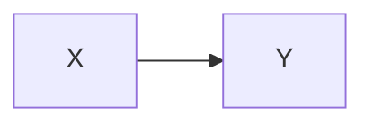

# M3 功能契约：Mermaid 图表 / 网络图片兼容 / 图片原位编辑

> 状态：v1（2026-10-20）｜ 目标：在 M2 基础上补 3 个能力；产出仍是**标准 Marp Markdown**。
> 通用约定沿用 `docs/API_CONTRACT.md`；所有权与互不越界规则见各任务卡。

---

## 1. Mermaid 图表（owner 模块：mermaid-eng；集成：marp-tech）

### 1.1 用户写法（与主流 Markdown 一致，无需任何标记）

````markdown

````

- 也兼容 ```mmd / ```mermaid 之外的常见别名：`mermaid`、`mmd`（只识别这两种，避免误伤）。
- 渲染失败时**保留原代码块**并在预览中给出可读提示（不能白屏/报错崩溃）。
- 生成物是标准 Marp：图在 `markdown` 里仍是代码块，仅渲染层转 SVG（拷回 VS Code 时由用户插件决定，不影响内容）。

### 1.2 交付模块 `web/src/mermaid/**`（mermaid-eng 写）

```ts
export function hasMermaid(html: string): boolean
export async function loadMermaid(): Promise<void>                 // 懒加载 /mermaid.browser.js（IIFE，全局 MermaidBundle）
export async function renderMermaidInHtml(html: string): Promise<string>
export function applyMermaidCacheSync(html: string): string        // 同步路径（画廊缩略图等）用缓存替换
export function clearMermaidCache(): void
export function resetMermaidForTest?(): void                       // 可选
```

- `renderMermaidInHtml`：解码 HTML 里的 mermaid 代码块（`<pre><code class="language-mermaid">…</code></pre>`，代码块内容要做 HTML 实体反转义），用 `await MermaidBundle.default.render(id, code)` 得到 SVG，替换为：
  ```html
  <div class="mwb-mermaid" data-mermaid-hash="<sha1(code)>"><svg …>…</svg></div>
  ```
  再对 SVG 做必要清理（去掉固定 width/height 或改成 100% 宽自适、保留 viewBox、把 `max-width` 交给 CSS）。
- 缓存：`hash(code) → svg`，供 `applyMermaidCacheSync`（画廊缩略图/主题编辑器预览等同步渲染路径）与重复渲染复用。
- 初始化：`mermaid.initialize({ startOnLoad: false, securityLevel: 'strict', theme: 'default', htmlLabels: false, fontFamily: 'Microsoft YaHei, PingFang SC, Segoe UI, sans-serif', flowchart:{useMaxWidth:true}, sequence:{useMaxWidth:true} })`（最终以打印/PDF 实测为准，`htmlLabels` 选择写入文档）。
- ID 唯一：每次 render 用 `mwb-mermaid-<counter>-<rand>`，避免同页多图冲突；渲染前确保容器存在于 document（mermaid 需要 DOM 测量）。
- 错误处理：单块渲染失败 → 捕获并保留原代码块 + `<div class="mwb-mermaid-error">图表渲染失败：…</div>`；不影响其它块。
- **离线**：mermaid 必须本地打包（禁止 CDN）；`/mermaid.browser.js` 由 `scripts/build-mermaid-bundle.mjs`（esbuild IIFE，global `MermaidBundle`）构建到 `web/public/`；**懒加载**：只有 `hasMermaid(html)` 才加载。
- **体积预算**：单文件 min ≤ 6MB（gzip ≤ 1.6MB）；报告实测 raw/min/gzip/brotli 写进 `docs/dev/mermaid.md`。若超预算，mermaid-eng 负责评估降级方案（如仅打包常用 diagram 的裁剪版/换 mermaid v10），并在文档给结论。
- 依赖版本：npm 上 `mermaid` latest 为 12.2.0（2026-10）。选稳定且体积可控的版本，锁定到 `web/package.json` 并说明理由。

### 1.3 集成（marp-tech）

- `web/src/marp/renderer.ts` 增加：
  ```ts
  async renderAsync(markdown, options?): Promise<RenderOutput>   // sync render + renderMermaidInHtml
  ```
  保留同步 `render()` 不变。
- `EditView.doRender` 改为异步（防抖已有；加自增 token 丢弃过期结果）；`resolvedHtml` 使用 `renderAsync` 结果 → PreviewPane / SlideNavigator 自动获得 SVG。
- 画廊缩略图：`renderForGallery` 同步路径追加 `applyMermaidCacheSync(html)`（主预览渲染后缓存已热）。
- 导出：`ExportPanel` 的 render 调用支持 Promise（一行 `await Promise.resolve(render())`）；`EditView.renderForExport` 改 async：`renderer.renderAsync(...)` 后再交给导出（保证 PDF/PPTX 里是图不是代码）。
- 工具栏增加「◈ 图表」按钮：插入
  ```
  ```mermaid
  graph LR
  A[开始] --> B[结束]
  ```
  ```
  模板并把光标放到落点；`EditorToolbar.vue`（marp-tech 所有）。
- 文档 `docs/dev/frontend.md` 增补 mermaid 段落。

### 1.4 Mermaid 验收（Lead 会写在 `scripts/visual-e2e-m3.mjs`）

1. deck 含 2 个 mermaid 块 + 普通页 → 预览出现 2 个 `.mwb-mermaid svg`；无 JS 错误；零外网请求。
2. 导出 PDF：页数正确、含该页、目检图是矢量图（截图）；导出 PPTX 解包正常。
3. 错误块（非法 mermaid 语法）→ 保留代码块 + 错误提示，不崩溃。
4. 首屏只有无 mermaid 的 deck 时 **不加载** mermaid.bundle（network 请求验证）。

---

## 2. 老 Markdown 的网络图片兼容（server：desktop-packaging；前端：export-eng；集成：marp-tech）

背景：现在插入图片会下载到 `assets/`，但老 md 里直接写 `` 无法显示（预览 iframe CSP 只允许 self/data/blob；离线要求 0 外网请求）。

### 2.1 服务端新增（desktop-packaging）

**A. 图片代理（预览/导出即时显示，不修改 md）**

| 方法 | 路径 | 说明 |
|---|---|---|
| GET | `/api/proxy/image?url=<encoded>&token=<mwb-token>` | 拉取远程图片并回传字节；用于预览（iframe 内 `` 不能带 header，故该路由允许 `token` 查询参数，**仅此路由**） |

要求：
- 仅 `http/https`；拒绝 `localhost`/私有网段/`*.local`/非图片 content-type；最大 15MB；超时 10s；最多 3 次重定向且每跳重新校验。
- 缓存到 `%TEMP%\MarpWorkbench\imgcache\<sha256>.<ext>`（TTL 7 天，启动清理），命中直接回；响应 `Content-Type`、`Cache-Control: private, max-age=86400`。
- 错误码：`BAD_REQUEST`（非法 url）/`NOT_FOUND`（404）/`EXPORT_FAILED` 风格可读中文（如"无法下载远程图片：域名不可达"）。
- 测试可开 `MWB_PROXY_ALLOW_PRIVATE=1`（**仅测试用**，文档标注）。

**B. 一键本地化（下载到 assets 并返回映射）**

| 方法 | 路径 | 说明 |
|---|---|---|
| POST | `/api/decks/:id/localize-images` | body `{urls: string[]}` → 逐张下载 → 存入 deck `assets/`（扩展名按 content-type）→ 返回 `{mapping: {"https://…":"assets/a.png"}, failed:[{url, reason}]}` |

- 复用 A 的下载管线；文件名 sanitize（`remote-<hash8>.<ext>`）；允许 0-50 个/次。
- 不修改 markdown，只下载；由前端做路径替换后保存。

### 2.2 前端（export-eng 写；marp-tech 挂载）

- `web/src/insert/remoteImages.ts`：
  ```ts
  export function findRemoteImages(markdown: string): { url: string; start: number; end: number }[]   //  与 
  export function replaceRemoteImages(markdown: string, mapping: Record<string,string>): string
  export async function localizeRemoteImages(deckId: string, markdown: string): Promise<{markdown, localized, failed}>
  export function proxyImageUrl(url: string): string    // → /api/proxy/image?url=…&token=…
  ```
- `RemoteImagesBanner.vue`：状态 props `{markdown}`，当发现网络图片时在编辑器顶部显示条：「检测到 N 张网络图片，下载到本地后离线也能看」+ 按钮「下载到本地」/「忽略」；下载中进度、失败可读提示、完成后 emit `{markdown}`（父组件替换内容并保存）。忽略状态记 localStorage（按 deckId）。
- 预览：`PreviewPane`（marp-tech 集成）在把 html 交给 iframe 前，把远程图片 URL 替换为 proxyImageUrl；导出同理（见 2.3）。
- 插入器 URL 输入：默认尝试「下载到本地」（调 A/B 或直接 localize），失败时回退插入原 URL 并提示"将联网显示"。
- 导出：`ExportPanel` 内联资产时，把 `http(s)://…` 图片也通过 proxy 取回 → dataURL 内联（已有 inline 逻辑扩展，export-eng 负责）。

### 2.3 marp-tech 集成

- EditView 挂 `RemoteImagesBanner`（编辑器顶部）；`@localized` → content 替换 + 保存 + 重渲染 + toast；资源缓存清理。
- PreviewPane：远程 URL → `/api/proxy/image?...&token=`（用 `getToken()`）；CSP 保持 `img-src 'self' data: blob:` 不变（代理是同源）。
- 导出 render 路径确保 html 里远程图片已被内联或代理化（与 export-eng 协调，导出面板已有 inline 化逻辑，优先由 ExportPanel 处理）。

### 2.4 网络图片验收

1. 用本地假 "远程" HTTP 服务（e2e 启 127.0.0.1 端口）图片 URL 写进 md：exe 以 `MWB_PROXY_ALLOW_PRIVATE=1` 启动 → 预览显示图片（proxy 请求 200）、无 404。
2. 点「下载到本地」→ md 里 URL 替换为 `assets/remote-*.png`、文件落盘、后续预览/导出离线可用。
3. 断网（或不用代理）时导出仍成功（若已本地化）；未本地化时导出内联失败要有可读提示。

---

## 3. 图片原位编辑（对话框：export-eng；编辑区：marp-tech）

需求：光标停在已插入图片所在行，点工具栏「🖼 图片」→ 进入**编辑当前图片属性**模式（不是再插一张）；保存后原位替换。

### 3.1 解析/替换工具（export-eng，`web/src/insert/compose.ts` 扩展）

```ts
export interface ParsedImage {
  line: number                        // 1-based
  start: number; end: number          // markdown 字符 range（整行或整块）
  raw: string
  kind: 'image' | 'background'
  path: string
  modifiers: string[]                 // ['bg','left:40%','opacity:.5','w:640px','cover',...]
}
export function parseImageAtLine(markdown: string, line1: number, tolerance?: number): ParsedImage | null
export function replaceImageAt(markdown: string, image: ParsedImage, snippet: string): string
```
- 识别 ``（任意 alt）与 ``；tolerance 默认 1 行（光标可在图片行上下 1 行）；忽略代码围栏内的行。
- `replaceImageAt` 用 `start/end` 精确替换，保留行尾换行与前后文。

### 3.2 ImageInsertDialog 扩展（export-eng）

- 新增 props：`initialImage?: ParsedImage | null`（提供时进入编辑模式）。
- 编辑模式：标题「编辑图片」、来源区展示当前图片（可「更换图片」重新上传）、所有选项用 `initialImage.modifiers` 预填（bg/left/right+ratio/opacity/width/cover/contain/fit/blur/grayscale）、按钮文字「保存修改」。
- emit 扩展：`insert: [{ snippet, mode, edit?: { line: number; start: number; end: number } }]`（编辑模式带 edit 信息；兼容旧签名，父组件按 edit 判断）。

### 3.3 EditView（marp-tech）

- 工具栏图片按钮点击：`const line = editorRef.getCursorLine()` → `parseImageAtLine(content, line)`：
  - 命中 → 打开对话框 `initial-image=…`、标题编辑模式；`@insert` → `replaceImageAt(content, parsed, snippet)` → 设置内容 + 保存 + 重渲染 + toast「图片已更新」；
  - 未命中 → 现有新建流程不变。
- 属性面板「更换背景图」保持走新建背景图模式（本页已存在背景图时 title 可提示"将替换本页背景图"，若已有 `![bg]` 行可复用编辑模式——尽力）。

### 3.4 验收

1. 插入一张图（普通）→ 光标放该行 → 点图片按钮 → 对话框标题"编辑图片"、选项预填；改宽度/透明度 → 保存 → md 该行被替换（**没有新增图片行**）、预览更新。
2. bg 左 40% 图 → 光标该行 → 编辑 → 改为右侧 60% → 保存 → md 为 `![bg right:60%]`，页面预览左右对调。
3. 光标不在图片行 → 点图片按钮仍是新建模式。

---

## 4. 写范围（避免冲突）

| 路径 | owner |
|---|---|
| `web/src/mermaid/**`、`scripts/build-mermaid-bundle.mjs`、`docs/dev/mermaid.md`、`spike/mermaid/**` | mermaid-eng |
| `web/src/insert/**`（除 EditorToolbar.vue）、`docs/dev/export.md`、`spike/export/**` | export-eng |
| `server/src/routes/proxy.rs`、`server/src/remote_image.rs`、`server/src/routes/mod.rs` 中挂载 1 行、`server/Cargo.toml`、`docs/dev/server.md`、`spike/packaging/**`（新验证脚本） | desktop-packaging |
| `web/src/views/EditView.vue`、`web/src/marp/renderer.ts`、`web/src/preview/PreviewPane.vue`、`web/src/insert/EditorToolbar.vue`、`web/src/integrations/optionalComponents.ts`、`web/src/marp/assets.ts`（如需）、`web/src/styles/main.css`、`web/src/themes/ThemeEditor.vue`（同步 mermaid 缓存，1 行）、`docs/dev/frontend.md` | marp-tech |
| 构建脚本/根 `package.json`、文档汇总、`scripts/visual-e2e-m3.mjs`、git | Lead |

---

## 5. 总验收（Lead）

`node scripts/visual-e2e-m3.mjs` 覆盖：mermaid 预览+PDF+错误块+懒加载、网络图片代理显示+本地化+导出、图片原位编辑（普通+bg），加上 M1/M2 回归脚本全绿；exe 体积 ≤ 20MB；零外网请求（mermaid/proxy 除外，proxy 只在本机测）；截图给用户。
