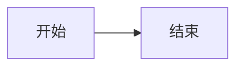

# M5.0 契约：Mermaid 图表尺寸 + 示例库（插入/编辑对话框）

> 状态：v1（2026-11-22）｜ 用户需求：
> 1. "添加一个 mermaid 添加图大小设置的选项，现在的图太小了，如果难度太大的话就渲染的大一点。"
> 2. "添加 mermaid 图时，各个类型的图加示例，方便用户编辑。"

---

## 1. 渲染尺寸引擎（owner: mermaid-eng）

### 1.1 默认放大（必须）

现状问题（`web/src/mermaid/replace.ts`）：`cleanupMermaidSvg()` 保留 mermaid 的 `max-width:<自然宽度>px`，小图（如 2 节点流程图自然宽 300px）只显示 300px；最大高度 560px。

修复后默认样式（无任何指令时）：

```css
display:block; width:100%; height:auto; max-width:100%; max-height:560px; margin:0 auto;
```

即：**取消自然宽度上限**，小图放大到容器宽度（文字随 SVG 等比放大）；最大高度保持 560px 防溢出。纯 CSS，SVG 矢量不糊。

### 1.2 每图尺寸指令

Mermaid 忽略 `%%` 注释行，因此把尺寸指令写在代码块**前 5 行内**（推荐第 1 行）：



支持的取值（大小写不敏感，允许 `large`/`大` 等别名）：

| 指令值 | 效果（SVG style） |
|---|---|
| 缺省 / `auto` | `max-width:100%; max-height:560px`（新默认，放大） |
| `s` / `small` / `小` | `max-width:60%; max-height:480px` |
| `m` / `medium` / `中` | `max-width:80%; max-height:540px` |
| `l` / `large` / `大` | `max-width:100%; max-height:560px` |
| `xl` / `xlarge` / `超大` | `max-width:100%; max-height:640px` |
| `NN%`（10–100） | `max-width:NN%; max-height:560px` |
| `NNNpx`（200–1200） | `max-width:NNNpx; max-height:560px` |

指令行保留在源码中（mermaid 当注释忽略），便于下次编辑。

### 1.3 模块 API（`web/src/mermaid/**`）

新建 `size.ts`：

```ts
export type MermaidSizePreset = 'auto' | 's' | 'm' | 'l' | 'xl' | 'custom'
export interface MermaidSize {
  preset: MermaidSizePreset
  label: string              // 中文显示名
  maxWidth: string           // CSS 值，如 '100%' / '60%' / '900px'
  maxHeightPx: number        // 480/540/560/640
  directiveValue?: string    // 插入到 Markdown 的值（auto 时为 undefined）
}
export function parseMermaidSize(code: string): MermaidSize
export function serializeMermaidSize(preset: MermaidSizePreset, customValue?: string): string | null
export function getMermaidSizeOptions(): { value: string; label: string }[]
export function stripMermaidSizeDirective(code: string): string // 可选（预览/统计用）
```

修改：
- `cleanupMermaidSvg(svg: string, size?: MermaidSize): string` —— 按 size 生成 style；默认新样式见 §1.1。
- `renderMermaidInHtml` / `applyMermaidCacheSync` 两条路径都 `parseMermaidSize(block.code)` 后传入 cleanup（缓存 key 用 code 原文即可，不同 size 指令 code 不同）。
- `index.ts` 新增导出：
```ts
/** 供「图表插入/编辑」对话框做实时预览：渲染单个代码块为清理后的 SVG（不写缓存） */
export async function renderMermaidPreview(code: string): Promise<string>
```
  内部：`loadMermaid()` → `renderMermaidSvg(uniqueId, code)` → `cleanupMermaidSvg(svg, parseMermaidSize(code))`；失败抛可读 Error。
- 保持无 mermaid deck 不加载 bundle；错误块行为不变。

### 1.4 验收

- `node spike/mermaid/run-unit-test.mjs`、`run-render-test.mjs`、`run-print-test.mjs` 增加/更新 size 用例并全绿。
- 默认渲染后 SVG style 含 `max-width:100%`（旧实现为自然 px）。
- 指令 s/m/l/xl/70%/900px 分别得到对应 max-width/max-height。
- PDF 打印：xl 图不溢出 16:9（若溢出则下调 xl max-height 并记录）。
- 记录 1 个小图（2 节点）在默认尺寸下渲染宽度提升数据（前一版 vs 本版）。

---

## 2. 图表示例库 + 插入/编辑对话框（owner: marp-tech/frontend）

### 2.1 组件

新建 `web/src/insert/MermaidInsertDialog.vue`，并在 `web/src/integrations/optionalComponents.ts` 以 Async 形式注册（glob 自动发现即可）。

Props：

```ts
{
  markdown?: string
  currentPage?: number
  initialBlock?: {
    from: number; to: number      // markdown 字符 offset
    code: string                  // 不含 fence 的 mermaid 源码
    preset: MermaidSizePreset
    customValue?: string
    line: number                  // fence 起始行（1-based）
  } | null
}
```

Emits：

```ts
insert: { snippet: string; mode: 'insert' | 'edit'; from?: number; to?: number; cursorLine?: number }
close: []
```

- 标题：新建时「插入 Mermaid 图表」；编辑时「编辑 Mermaid 图表」，按钮「保存修改」。
- 编辑模式：预填源码 + 尺寸；保存后由 EditView 原位替换原代码块（不新增块）。

### 2.2 示例库（19 类，全部必须真实可渲染）

| key | 中文名 | 模板要点 |
|---|---|---|
| flowchart | 流程图 | `graph LR` + 判断分支 |
| sequence | 时序图 | `sequenceDiagram` + 参与者/消息/备注 |
| class | 类图 | `classDiagram` + 类/属性/关系 |
| state | 状态图 | `stateDiagram-v2` + 状态迁移 |
| er | 实体关系图 | `erDiagram` + 实体/关系 |
| gantt | 甘特图 | `gantt` + 日期/任务 |
| pie | 饼图 | `pie title ...` |
| mindmap | 思维导图 | `mindmap` + 根/分支 |
| timeline | 时间线 | `timeline` + 时间点 |
| journey | 用户旅程 | `journey` + 步骤/评分 |
| quadrant | 象限图 | `quadrantChart` + 2×2 矩阵（优先级/定位） |
| xychart | 柱状/折线图 | `xychart-beta` + bar/line（轴标签可中文，需引号） |
| sankey | 桑基图 | `sankey-beta` + 流量/转化（mermaid v12 节点名暂只支持英文） |
| radar | 雷达图 | `radar-beta` + axis/curve（轴用带标签写法） |
| treemap | 树图 | `treemap-beta` + 层级数值（占比构成） |
| block | 块图 | `block-beta` + 列/块/连线（架构/流程） |
| git | Git 图 | `gitGraph` + branch/checkout/merge（研发流程） |
| c4 | C4 上下文图 | `C4Context` + Person/System/Rel（系统架构） |
| kanban | 看板 | `kanban` + 列/卡片（项目状态） |

模板用中文示例内容（方便直接改）；每张类型卡显示图标/名称，点击切换代码（覆盖当前代码，无需确认，但保留撤销？——不做复杂确认）。

### 2.3 布局（参考 ImageInsertDialog 风格，全中文）

- 弹窗约 980×640，三栏：
  - 左：类型卡片列表（2 列，可滚动）
  - 中：Mermaid 代码 textarea（等宽、行号可选、min-height 260px）+ 提示「直接修改示例中的文字即可」
  - 右：实时预览（白底/主题边框，渲染出错显示中文错误）+ 尺寸下拉（自动（推荐）/小/中/大/超大/自定义百分比）+ 自定义百分比输入（1–100，仅自定义时显示）
- 底部：取消 / 插入图表（编辑时为保存修改）
- 实时预览：400ms 防抖，调用 `renderMermaidPreview(code)`；请求 token 防竞态；无 mermaid 时显示空态。
- 弹窗内 `Esc` 关闭；打开时自动聚焦代码框；插入后关闭。
- 代码框内容保存时：若 size preset ≠ auto，在 fence 内第一行插入 `%% mwb-size: <value>`（若原代码已有指令则替换，不能重复）。

### 2.4 编辑器/EditView 集成

1. `EditorApi` 增加：
```ts
replaceRange(from: number, to: number, text: string, cursorLine?: number): void
```
   `CodeMirrorEditor.vue` 用 `view.dispatch({ changes: { from, to, insert: text }, selection: { anchor: ... } })` 实现（保留撤销历史），并 `focus()`。
2. 新建 `web/src/insert/mermaidBlock.ts`：
```ts
export interface MermaidBlockRef {
  from: number; to: number       // 字符 offset（包含 fence 与代码）
  line: number                   // fence 起始行 1-based
  code: string                   // 不含 fence
  preset: MermaidSizePreset
  customValue?: string
}
/** 光标所在行 ±1 命中 ```mermaid / ```mmd 代码块（fence 内也算）时返回块信息 */
export function findMermaidBlockAtLine(markdown: string, line1: number, tolerance = 1): MermaidBlockRef | null
```
   实现要正确跳过未闭合/其它语言的 fence；返回的 `from/to` 必须精确到原 Markdown 字符，用于原位替换。
3. `EditView.vue`：
   - `onInsertChart()` 改为打开对话框：光标在 mermaid 块内（±1 行）→ `initialBlock` 编辑模式；否则新建模式。
   - 对话框 `@insert`：insert → `editorRef.insertText(snippet + '\n', { block: true })`；edit → `editorRef.replaceRange(from, to, snippet, 起始行)`。
   - 提示文案：「已插入图表」/「图表已更新」。
4. `EditorToolbar.vue` 图表按钮 title 改为「插入 / 编辑 Mermaid 图表」；`insertChart` 事件语义改为打开对话框（事件名可保留）。

### 2.5 验收（Lead e2e）

脚本 `scripts/verify-mermaid-ui.mjs`（真实 exe + Chrome）：

1. 新建 deck → 点「◈ 图表」→ 对话框出现，类型卡 ≥ 19，预览 SVG 出现。
2. 点「时序图」→ 代码框含 `sequenceDiagram`，预览更新。
3. 尺寸选「超大」→ 插入 → Markdown 含 ````mermaid`、`%% mwb-size: xl`、`sequenceDiagram`；预览 SVG style 的 `max-height:640px`。
4. 光标放在该代码块内 → 再点「◈ 图表」→ 标题「编辑 Mermaid 图表」、代码预填；尺寸改「自定义 70%」→ 保存 → Markdown 中该块仍只有 1 个（原位替换），指令为 `%% mwb-size: 70%`，预览 SVG `max-width:70%`。
5. 默认（自动）插入的小图，渲染宽度 > 旧自然宽度（可对比截图/样式）。
6. 零 JS 错误；截图 3 张（对话框/插入后/编辑后）。
7. 回归：M3（mermaid 21/21）、M4（可编辑 23/23）、M1/M2/M2.1、冒烟全绿。

---

## 2.6 测试选择器（Lead e2e 依赖，务必实现）

| 元素 | 要求 |
|---|---|
| 对话框根 | `class="mwb-mermaid-dialog"`（role=dialog） |
| 类型卡 | `button.mwb-mermaid-type[data-type="flowchart|sequence|class|state|er|gantt|pie|mindmap|timeline|journey"]`（10 个） |
| 代码框 | `textarea.mwb-mermaid-code`（value 为当前 mermaid 源码，含尺寸指令时也在此） |
| 预览容器 | `.mwb-mermaid-preview`（内含 `svg`；失败时含 `.mwb-mermaid-preview-error`） |
| 尺寸下拉 | `select.mwb-mermaid-size`（value：auto/s/m/l/xl/custom） |
| 自定义输入 | `input.mwb-mermaid-custom`（type=number，自定义时显示） |
| 主按钮 | `button.primary`（文案「插入图表」/「保存修改」） |
| 取消/关闭 | `button.mwb-mermaid-cancel` 或文案「取消」 |

---

## 3. 写范围

| 路径 | owner |
|---|---|
| `web/src/mermaid/**`、`spike/mermaid/**`、`docs/dev/mermaid.md` | mermaid-eng |
| `web/src/insert/MermaidInsertDialog.vue`、`web/src/insert/mermaidBlock.ts`、`web/src/integrations/optionalComponents.ts`、`web/src/views/EditView.vue`、`web/src/insert/EditorToolbar.vue`、`web/src/editor/{types.ts,CodeMirrorEditor.vue}`、`web/src/styles/main.css`、`docs/dev/frontend.md` | marp-tech/frontend |
| `scripts/verify-mermaid-ui.mjs`、`docs/M5_PLAN.md`、版本/发布 | Lead |

不新增运行时依赖；不执行 git commit；不改对方文件。
