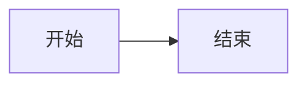

# Mermaid 图表模块（M3-1 + M5.0-A，mermaid-eng）

> 状态：**M3-1 完成**（2026-10-20）；**M5.0-A 尺寸引擎完成**（2026-11-22）｜契约依据：`docs/UI_CONTRACT_M3.md` §1、`docs/UI_CONTRACT_M5_MERMAID.md` §1（§1.2 预设表 / §1.3 API / §1.4 验收）
> 交付代码：`web/src/mermaid/**`（模块，M5 新增 `size.ts`）、`scripts/build-mermaid-bundle.mjs`（离线打包）、`web/public/mermaid.browser.js`（构建产物）
> 自测脚本/产物：`spike/mermaid/**`（报告 `spike/mermaid/out/*-report.json`，截图 `spike/mermaid/shots/`，产物已 gitignore）
> 集成方：frontend-core（`web/src/marp/renderer.ts` 的 `renderAsync` / EditView / `renderForExport` / 画廊缩略图 / M5 插入对话框），**本模块不改 renderer/EditView**

---

## 0. TL;DR（实测数字）

| 项目 | 实测结果 |
|---|---|
| bundle 体积 | **5.01 MB min** / **1.43 MB gzip** / **1.06 MB brotli**（预算：≤6MB min、≤1.6MB gzip ✅） |
| 打包 | esbuild IIFE，全局 `window.MermaidBundle = { default, mermaid }`，mermaid **12.2.0** 全依赖内联、零 CDN |
| 懒加载 | 无图 deck **0 次**请求 `/mermaid.browser.js`；有图第一次 **1 次**，之后复用（`performance.getEntriesByType('resource')` + puppeteer 网络双向验证） |
| 首图渲染耗时 | **2.3s**（首次，含 5MB 本地 bundle 加载 + parse + initialize + 2 张图）/ **1.4s**（复测，OS 文件缓存已热）；之后同代码命中缓存 ~0ms，`applyMermaidCacheSync` **1–5ms** |
| **默认放大（M5 核心）** | 取消 mermaid 自然宽度上限：**2 节点 `graph LR A-->B` 自然宽 360px → 渲染宽 1123px（+212%）**；4 节点流程图 665px → **1123px（+69%）**；小图文字随 SVG 等比放大不糊 |
| **尺寸指令（M5）** | `%% mwb-size: s|m|l|xl|70%|900px`（代码块前 5 行内、大小写不敏感、非法回退 auto）；实测每档 `max-width/max-height` 精确生效，指令不破坏渲染 |
| 预览（真实 marp-core） | 2 个 `.mwb-mermaid svg` + 1 个 `.mwb-mermaid-error`（保留原代码块）；**零 JS 错误、零 404、零外网请求**；默认放大后流程图 1123×316、时序图 1123×560，均在 16:9 slide 内 |
| 尺寸 deck（9 页） | 18/18 checks：s=674×189、m=898×253、l=1123×560、xl=1123×640（无标题页底边余 **1.5px**，不溢出）、70%=786×221、900px=900×253、非法/超 5 行指令回退 auto |
| PDF（无头 Chrome 打印） | 主 deck 3 页 **960×540pt**、**239.6 KB**、打印完成 **3.5–6.0s**；尺寸 deck 9 页 **960×540pt**、511.6 KB、**5.1–5.7s**；**中文标签文本可提取**、主体为矢量路径、无页眉页脚、xl 页无裁切 |
| `htmlLabels` | **选 `false`**（SVG `<text>`，无 foreignObject）；对比实测见 §6.3（`true` 在 Chrome PDF 也通过，列为备选） |
| 自测 | 纯函数单测 **23/23**、真实 Chrome 渲染 **28/28**、懒加载 **9/9**、尺寸引擎 **18/18**、打印 PDF **23/23**、htmlLabels 对比 **10/10**；frontend-core 的 `web/scripts/verify-ui-m3.mjs` 集成验证全绿 |

---

## 1. 为什么是 mermaid（对比 PlantUML / Graphviz / D2）

用户诉求是「在 PPT/Marp 的 Markdown 里直接写图」。评选维度按本项目实际约束排序：
① Markdown 围栏生态是否事实标准 → ② 能否**纯浏览器、完全离线**渲染 → ③ 图表种类是否覆盖演示场景 → ④ 体积/集成成本可控。

| 维度 | **Mermaid** | PlantUML | Graphviz | D2 |
|---|---|---|---|---|
| 语言/形态 | TypeScript，纯前端 JS | Java，`java -jar plantuml.jar` 或 Docker/在线服务器 | C 原生程序（DOT 语言 + dot/neato… 布局引擎） | Go 独立 CLI；浏览器需 WASM（D2.js） |
| 许可证 | MIT | LGPL-3.0 | EPL/开源 | MPL-2.0 |
| 社区体量（2026-10-20 查） | 90,770 stars；npm **1097 万次/周** | 13,375 stars | 老牌图可视化项目（Graphviz 官网） | 25,691 stars |
| 浏览器原生 | ✅ 官方 ESM/IIFE，`mermaid.render()` | ❌ 需 JVM/服务端代理 | ❌ 原生库；Web 需 WASM 封装 | ⚠️ 有 WASM（D2.js），但主形态是 Go CLI |
| Markdown 围栏 | ✅ 事实标准：GitHub/GitLab/GitLab Pages、Obsidian、Typora、VS Code、Marp 社区都按 ` ```mermaid ` 识别 | ⚠️ 需要插件/服务器（GitLab 集成需服务端） | ⚠️ 一般写 `dot` 代码块，需插件 | ⚠️ 生态支持少（`d2` 围栏） |
| 图表种类（演示常用） | flowchart/sequence/class/state/ER/gantt/pie/mindmap/timeline/block… 覆盖 | 很强（UML 系最全） | 只有图论布局（无时序/类图语义） | 流程/架构图强，图表种类少于 mermaid |
| 中文标签 | ✅ 系统字体（Microsoft YaHei 等），实测 PDF 可提取 | 依赖服务端字体 | 依赖本机字体/配置 | 依赖 WASM 字体 |
| 集成结论 | **✅ 选它** | ❌ exe 内嵌 JVM 不现实（体积/启动/分发） | ❌ DOT 语法不适合「非技术用户写演示」 | ❌ 额外 WASM 胶水 + 围栏生态弱 |

**结论：选 mermaid。** 它是唯一同时满足「用户已经会写、Markdown 围栏事实标准、纯前端离线可打包、体积可接受」的方案。
PlantUML 的 UML 表达力更强，但需要 JVM/服务端；Graphviz 是布局引擎而不是演示级图表语言；D2 语法现代但浏览器内嵌是 WASM 路径、且用户 Markdown 里几乎不会写 `d2` 围栏。

来源：
- mermaid 仓库/社区数据：<https://github.com/mermaid-js/mermaid>（API 实测：90,770 stars、MIT、2026-10-20 仍在活跃提交），npm 周下载 <https://api.npmjs.org/downloads/point/last-week/mermaid>（10,970,911）
- mermaid 12.0.0 变更（ELK 默认、neo 主题、ES2024）：<https://github.com/mermaid-js/mermaid/releases/tag/mermaid%4012.0.0>
- PlantUML 需要 Java（本地安装前置条件）：<https://plantuml.com/starting>；仓库数据：<https://github.com/plantuml/plantuml>
- Graphviz 定位与 DOT 语言：<https://graphviz.org/about/>、<https://graphviz.org/doc/info/lang.html>
- D2 FAQ（浏览器运行需 WASM / D2.js；Go CLI）：<https://d2lang.com/tour/faq/>；仓库数据：<https://github.com/d2lang/d2>

---

## 2. 版本选择：mermaid **12.2.0**（锁定）

- 契约 §1.2 记录 npm latest 为 12.2.0（2026-10）；`web/package.json` 用精确版本 `"mermaid": "12.2.0"`，避免上游 minor/patch 漂移改变图表外观或体积。
- v12 是**破坏性大版本**：ELK 成为默认布局、`neo` 外观成为默认 look、要求 ES2024（Safari 17.4+ / Node 22.12+）。本项目用户环境是 Windows 本机 Chrome/Edge 155，满足要求；bundle `target: ['chrome110','edge110']` 只影响语法降级，实际运行在用户本机新版 Chromium。
- 默认观感 = v12 默认（ELK 布局 + neo purple 主题）。实测流程图/时序图中文渲染正常，见 §6 截图。
- 降级预案（**未触发**，体积在预算内）：若未来版本超预算或 v12 出现渲染 bug → 回退 `11.17.2`（v11 稳定线）或 v10；再不行才评估「只注册常用 diagram + 排除 cytoscape/elk」的裁剪入口。`scripts/build-mermaid-bundle.mjs` 会在超预算时**非 0 退出并打印降级方向**。

---

## 3. 离线打包（scripts/build-mermaid-bundle.mjs）

```powershell
pnpm --dir web add mermaid    # 唯一新增依赖（已锁 12.2.0）
node scripts/build-mermaid-bundle.mjs
# [build-mermaid-bundle] mermaid@12.2.0（esbuild 0.28.2）
#   raw  11.80 MB（gzip 2.00 MB，5002 ms，仅测量）
#   min  5.01 MB  ← 实际加载体积（3010 ms）
#   gzip 1.43 MB / brotli 1.06 MB（min 产物压缩后）
#   预算：min ≤ 6 MB（5.01 / 6）、gzip ≤ 1.6 MB（1.43 / 1.6）
# 完成：体积在预算内。
```

- 产物：**`web/public/mermaid.browser.js`**（Vite `public/` → `web/dist/` → rust-embed 进 exe；与 `marp-core.browser.js` 同一机制）。
- 形态：esbuild **IIFE**，`globalName: 'MermaidBundle'`，入口 `import mermaid from 'mermaid'; export default mermaid; export { mermaid }`。
  调用侧：`window.MermaidBundle.default.render(id, code)`；`window.MermaidBundle.mermaid` 同对象（兼容写法）。
- 为什么入口用 package specifier：mermaid 12 明确说明 `dist/mermaid.esm.min.mjs` 含 `es-module-lexer`（Vite）拒绝的语法，**必须从包名导入 core build**；esbuild 走包名解析，没问题。
- 为什么能打出 5.01MB：v12 的 ESM core 通过动态 import 拆分 diagram chunk，esbuild IIFE 不支持 code-split → 全部内联（flowchart/sequence/class/state/ER/gantt/pie/mindmap/timeline + d3/dagre/elk/cytoscape/katex/…）。
  参考：上游单文件 `mermaid.min.js` 为 5.49MB min / 1.51MB gzip，我们 esbuild 产物略小（5.01MB / 1.43MB）。
- 首次冷构建约 100s（esbuild 冷启动 + 杀软扫描），热构建 min 产物约 **3s**；`raw` 版本同时构建只为给出 minify 收益（11.80→5.01MB），不落盘。
- 离线保证：产物内无 `cdn.jsdelivr.net`/`unpkg`/`cdnjs` 引用（脚本内置检查，仅打印告警）；运行时 **0 外网请求**（§5 实测）。
- 构建顺序建议：`build:mermaid` → `build:marp` → `pnpm --dir web build` → `cargo build --release`。
  **注**：根 `package.json` 的 `build` 编排与 `.gitignore` 里 `web/public/mermaid.browser.js` 的忽略规则属 Lead 范围，本任务未改（已在给 Lead 的消息里说明）。
  当前 `pnpm --dir web build` 已能把产物拷进 `web/dist/mermaid.browser.js`（5.25MB = min + 注释 banner 等），Vite 主 bundle 不含 mermaid。

---

## 4. 模块 API 与实现（web/src/mermaid/**）

### 4.1 契约导出

```ts
export function hasMermaid(html: string): boolean
export async function loadMermaid(): Promise<void>                       // 懒加载 + initialize
export async function renderMermaidInHtml(html: string): Promise<string>
export function applyMermaidCacheSync(html: string): string
export function clearMermaidCache(): void

// M5.0-A 尺寸引擎（契约 UI_CONTRACT_M5_MERMAID §1.3）：
export type MermaidSizePreset = 'auto' | 's' | 'm' | 'l' | 'xl' | 'custom'
export interface MermaidSize { preset; label; maxWidth: string; maxHeightPx: number; directiveValue?: string }
export function parseMermaidSize(code: string): MermaidSize
export function serializeMermaidSize(preset: MermaidSizePreset, customValue?: string): string | null
export function getMermaidSizeOptions(): { value: string; label: string }[]
export function stripMermaidSizeDirective(code: string): string          // 可选工具
export async function renderMermaidPreview(code: string): Promise<string> // 插入/编辑对话框实时预览（不写缓存，失败抛可读 Error）

// 额外（测试/诊断，非契约必选）：
export function resetMermaidForTest(): void
export function mermaidCacheSize(): number
export function parseMermaidSizeValue(rawValue: string): MermaidSize | null
export function findMermaidSizeDirective(code: string): { lineIndex: number; rawValue: string } | null
export const MERMAID_BUNDLE_URL = '/mermaid.browser.js'
export const MERMAID_INIT_CONFIG = {...}
export const MERMAID_SVG_MAX_HEIGHT_PX = 560
```

文件分工：`index.ts`（公共 API/缓存编排/尺寸套用）、`bundle.ts`（懒加载/初始化/串行渲染/离屏测量容器）、`replace.ts`（代码块提取、实体反转义、SVG 清理、模板 id、错误块）、`size.ts`（M5 尺寸指令解析/序列化/预设表）、`hash.ts`（同步 SHA-1）、`types.ts`（类型）。

### 4.2 处理流程

1. `hasMermaid(html)`：正则匹配 `<code class="…language-mermaid|language-mmd…">`；**无图直接原样返回，不加载任何资源**。
2. `renderMermaidInHtml(html)`：先 `loadMermaid()`（失败则所有块降级成「原代码块 + 中文提示」，**不抛错**）。
3. 逐块提取：`<pre …><code …>innerHTML</code></pre>` → 去标签（防御性）+ **HTML 实体单趟反转义**（`--&gt;` → `-->`，`&amp;lt;` 不会二次解码）→ mermaid 源码。
4. 渲染：`MermaidBundle.default.render(<唯一 id>, code, <离屏容器>)`；id = `mwb-mermaid-<计数>-<随机>`；所有 render 串行（mermaid v12 内部也是队列，外面再串一层保证共享容器安全）。
5. SVG 清理（`cleanupMermaidSvg(svg, size?)`，**M5 改造**）：
   - 保留 `viewBox`（矢量缩放关键）；
   - 去掉固定 px 的 `width`/`height` 属性，并**去掉 mermaid 自带的自然宽度上限**（旧版保留 `max-width:<自然宽度>px`，导致小图只有 ~360–665px）；
   - 默认（无指令）：`display:block;width:100%;height:auto;max-width:100%;max-height:560px;margin:0 auto` → **小图放大到容器宽度，文字随 SVG 等比放大**；
   - 传入 `MermaidSize` 时按契约映射：`s`=60%/480、`m`=80%/540、`l`=100%/560、`xl`=100%/640、自定义 `NN%`/`NNNpx`（max-height 均为 560）；
   - 样式全部内联 → 预览 iframe / 打印页 / 导出 HTML 都不依赖应用 CSS。
6. 输出：`<div class="mwb-mermaid" data-mermaid-hash="<sha1(code)>" style="display:flex;…"><svg…></div>`。
7. 缓存：`sha1(code) → mermaid 原始 SVG 模板`（render id 占位化 `__MWB_MERMAID_ID__`；**尺寸样式不缓存**，输出时按 `parseMermaidSize(code)` 套用）。
   这样**同一段 mermaid 代码在同一个 deck 出现两次**也不会产生重复 DOM id / marker 引用串味（实测 §5 第 4 项）；异步 + 同步缓存两条路径输出一致。
8. 错误块：`原代码块 + <div class="mwb-mermaid-error" role="alert">图表渲染失败：<原因>（已保留原始代码块）</div>`，单块失败不影响其它块。

### 4.3 初始化配置（最终值）

```ts
{
  startOnLoad: false,
  securityLevel: 'strict',        // 禁止 click/内联 HTML 注入；离线静态图最稳
  theme: 'default',               // mermaid 自身配色（不跟 Marp 主题联动，见 §7 限制）
  htmlLabels: false,              // 实测决定，见 §6.3
  fontFamily: 'Microsoft YaHei, PingFang SC, Segoe UI, sans-serif',
  flowchart: { useMaxWidth: true },
  sequence: { useMaxWidth: true, wrap: false },
  suppressErrorRendering: true,   // 失败不往 document 插 mermaid 自带错误图
}
```

### 4.4 缓存语义

- 上限 500 条（防极端 deck 内存无界）；`clearMermaidCache()` 清空。
- `applyMermaidCacheSync(html)`：只替换**已缓存**的块，未命中保留代码块、绝不抛错（画廊缩略图/主题编辑器预览等同步路径依赖主预览先渲染过同一份代码）。
- `hash` 用**同步 SHA-1**（自实现，单测与 Node `crypto` 逐字节一致）：因为同步 API 不能用 `crypto.subtle.digest`（异步且需 secure context），同时 `data-mermaid-hash` 要稳定可复现。

### 4.5 尺寸引擎（M5.0-A，契约 `docs/UI_CONTRACT_M5_MERMAID.md` §1）

**问题**：旧实现把 SVG 的 `max-width` 锁在 mermaid 自然宽度（如 `graph LR A-->B` 只有 360px），用户反馈「图太小」。

**指令写法**（mermaid 把 `%%` 行当注释忽略，指令可一直留在源码里）：



- 必须在代码块**前 5 行内**（推荐第 1 行）；大小写不敏感；值两侧空格容忍。
- 别名：`auto`/`自动`、`s`/`small`/`小`、`m`/`medium`/`中`、`l`/`large`/`大`、`xl`/`xlarge`/`超大`。
- 自定义：`NN%`（1–100，推荐 ≥10；对话框范围 1–100）或 `NNNpx`（200–1200）。
- 非法值 / 越界 / 第 6 行之后的指令 → 回退 `auto`（不报错）。

| 指令值 | SVG `max-width` | SVG `max-height` | 尺寸 deck 实测（1280×720 页面，内容宽 1123px） |
|---|---|---|---|
| 缺省 / `auto` | `100%` | `560px` | 4 节点流程图 **1123×316**（旧 665×187） |
| `s` / `small` / `小` | `60%` | `480px` | 674×189 |
| `m` / `medium` / `中` | `80%` | `540px` | 898×253 |
| `l` / `large` / `大` | `100%` | `560px` | 1123×560 |
| `xl` / `xlarge` / `超大` | `100%` | `640px` | 1123×640（无标题页，底边余 1.5px，不溢出） |
| `NN%` | `NN%` | `560px` | 70% → 786×221 |
| `NNNpx` | `NNNpx` | `560px` | 900px → 900×253 |

**默认放大实测（本版 vs 旧版）**：
- 2 节点 `graph LR A[开始]-->B[结束]`：自然宽 **360px**，旧版渲染宽 = min(360, 1123) = **360px** → 新版 **1123px（+212%）**；
- 4 节点流程图：自然宽 **665px**，旧版 665px → 新版 **1123px（+69%）**；
- 时序图（天然较窄）：1123×560（高度受 560 上限，自动等比）。

> **Lead 验收补充（M5.0 实测关键点）**：Marp 主题的 `section` 常为 `display:flex; align-items:center` 纵向布局，mermaid wrapper 作为子项会被 **shrink-to-fit**；只把 SVG 改成 `width:100%; max-width:100%` 时真实图宽仍只有 ~300px（E2E 实测 chartW=300 / slideW=1280）。必须同时给 wrapper 加 `width:100%`（`replace.ts::WRAPPER_STYLE`），图才会真正铺满内容宽度（实测 1120/1280 = 88%）。

**16:9 高度限制（重要，已实测）**：
- 默认主题 section padding 78.5px → 内容区 1123×563；因此 `l=560` 只能贴合、`xl=640` 会伸进下 padding。
- **xl 在「只有图」的 16:9 页面**：图顶 78.5 + 640 = 718.5 ≤ 720，**不溢出**（底边余 1.5px，PDF 实测同样贴合）。
- **xl + 标题（h1）同页**：实测图底部 806.4px > 720px，**溢出 86.4px**（marp 不会对整页内容自动缩放，只有 code/math 等元素有 auto-scaling）；`l + 标题` 实测底部余 7.1px，安全。→ **超大图请用无标题页/短标题，或选「大」**（已写入 §10 已知限制）。
- 未下调 xl=640：一是不带标题的 16:9 页实测不溢出（契约值可用），二是再降就会低于 `l=560` 造成预设顺序倒挂。

**API**（`size.ts`，由 `index.ts` 转出，marp-tech 的 M5-B 对话框直接 `import ... from '../mermaid'`）：

```ts
parseMermaidSize(code): MermaidSize                 // 前 5 行找指令；非法→auto
serializeMermaidSize(preset, customValue?): string | null  // auto→null；custom 校验 %/px
getMermaidSizeOptions(): {value,label}[]            // auto/s/m/l/xl/custom 六项
stripMermaidSizeDirective(code): string            // 去掉指令行（可选工具）
renderMermaidPreview(code): Promise<string>        // 对话框实时预览：load→render→cleanup(按尺寸)，不写缓存，失败抛可读 Error
```

> `renderMermaidPreview` 与主渲染使用同一套 `cleanupMermaidSvg(…, parseMermaidSize(code))`，所以对话框预览 = 插入后效果（同一份 SVG style / 尺寸）。

---

## 5. 懒加载与真实 Chrome 渲染实测

脚本：`node spike/mermaid/run-render-test.mjs`（真实 marp-core 4.4.0 渲染 + 真实 Chrome 157 + puppeteer-core；页面 `spike/mermaid/page/test.html`、`page/lazy.html`）。

结果（`spike/mermaid/out/render-test-report.json`）：

| 检查 | 结果 |
|---|---|
| 真实 marp-core 输出含 3 个 `language-mermaid/mmd` 块 | ✅ |
| `renderMermaidInHtml` 后：2 个 `.mwb-mermaid svg` + 1 个 `.mwb-mermaid-error` | ✅ 28/28 checks |
| 错误块保留原代码 + 可读中文提示、不影响其它块 | ✅ |
| 同页多图 svg id 唯一；重复代码块出现两次也无重复 id | ✅ |
| 缓存命中再渲染：`data-mermaid-hash` 相同但 svg id 全部重新生成 | ✅ |
| `applyMermaidCacheSync` 命中（1–5ms）/ 清缓存后不替换且不抛错 | ✅ |
| 图在 slide 内不溢出（M5 默认放大后）：流程图 1123×316、时序图 1123×560 | ✅ |
| 零 JS 错误、零 console error、零 404 | ✅ |
| 网络：测试页 4 个请求、**mermaid bundle 1 次**、**外网 0** | ✅ |
| 懒加载：无图阶段 0 次请求；有图阶段恰好 1 次；重复渲染不再请求；全局 `MermaidBundle` 按需出现 | ✅ 9/9 checks |

耗时：marp 渲染 305ms；**首图 2338ms（首次）/ 1444ms（复测，OS 缓存热）**（bundle 5MB 本地加载 + init + 2 图）；缓存后同代码即时；整页测试 3.1s。

截图（`spike/mermaid/shots/`，均可在浏览器打开复核）：
- `deck-full.png`（整 deck）、`slide-1-flowchart.png`、`slide-2-sequence.png`、`slide-3-error.png`
- 尺寸专项：`size-deck-full.png`、`size-slide-1-auto-small.png` … `size-slide-9-line6-auto.png`（见 §5.2）

### 5.2 尺寸引擎真实渲染实测（M5.0-A）

脚本：`node spike/mermaid/run-size-test.mjs`（页面 `page/size.html`；9 页 deck：默认 auto / s / m / l（竖向图）/ xl（竖向图、无标题）/ 70% / 900px / 非法指令 / 第 6 行指令）。
结果（`spike/mermaid/out/size-test-report.json`）：**18/18 checks**，真实 Chrome 157，零外网/零 JS 错误。

| 页 | 指令 | SVG style max-width / max-height | 实测渲染（1280×720 页面，内容宽 1123px） | 是否在 slide 内 |
|---|---|---|---|---|
| 1 | 无（auto） | `100%` / `560px` | 1123×316 | ✅ |
| 2 | `s` | `60%` / `480px` | 674×189 | ✅ |
| 3 | `m` | `80%` / `540px` | 898×253 | ✅ |
| 4 | `l`（竖向图） | `100%` / `560px` | 1123×560（底边余 7.1px） | ✅ |
| 5 | `xl`（竖向图、无标题页） | `100%` / `640px` | 1123×640（底边余 1.5px） | ✅ |
| 6 | `70%` | `70%` / `560px` | 786×221 | ✅ |
| 7 | `900px` | `900px` / `560px` | 900×253 | ✅ |
| 8 | `999%`（非法） | `100%` / `560px`（回退 auto） | 1123×316 | ✅ |
| 9 | 第 6 行 `%% mwb-size: xl` | `100%` / `560px`（超 5 行不生效） | 1123×190 | ✅ |

压力用例（仅记录，不参与断言）：**xl + h1 标题同页 → 图底部 806.4px > 720px，溢出 86.4px**（marp 不会整页自动缩放）；`l + 标题` 实测安全（底边余 7.1px）。结论：xl 适合无标题/短标题的大图页，见 §10 限制。

其它 API 断言（同页真实浏览器内）：
- `renderMermaidPreview` 无指令 → `max-width:100%`；`s` → 60%/480px；`xl` → `max-height:640px`；`900px` → `max-width:900px`；
- 每次调用生成唯一 svg id、**不写全局缓存**（`mermaidCacheSize()` 前后不变）；
- 空代码抛「Mermaid 代码为空，无法预览」；非法语法抛「Mermaid 渲染失败：…」（对话框直接显示）。

---

## 6. 打印 / PDF 保真实测（无头 Chrome）

脚本：`node spike/mermaid/run-print-test.mjs`
链路 = 真实导出链路：真实 marp-core deck（含 mermaid 图）+ marp CSS + 内联 `browser_helper`（`server/src/export/browser_helper.js`）→ 打印页（`@page{size:1280px 720px;margin:0}`、`print-color-adjust:exact`、每页 `break-after:page`，规则与 `server/src/export/print_page.rs` 一致）→ 无头 Chrome 打印（参数与 `server/src/export/pdf.rs` 一致：`--headless=new --disable-gpu --no-pdf-header-footer --virtual-time-budget=8000`）。

### 6.1 结果（`spike/mermaid/out/print-test-report.json`、`out/print-deck.pdf`）

| 检查 | 结果 |
|---|---|
| PDF 页数 = 3 | ✅ |
| 每页 **960×540pt**（=1280×720px 16:9） | ✅ |
| 中文标签可提取（flowchart：开始/检查/发布上线/修复；sequence：用户/系统/登录请求/返回令牌） | ✅ |
| 错误页保留 `graph LR` 原代码 + 「图表渲染失败」中文提示，文本可提取 | ✅ |
| 无页眉页脚（`--no-pdf-header-footer`，无 URL/日期） | ✅ |
| 所有文本坐标在页内（无裁切） | ✅ |
| 图主体为矢量：p1 路径 21 条 / p2 22 条 / p3 12 条，无整页位图 | ✅ 23/23 checks（含 §6.4 尺寸 deck） |
| 打印耗时 | **pdfReady 3.5–6.0s**（3 页，含 Chrome 冷启，与 M1 实测 4.13s 同量级） |
| PDF 体积 | **239.6 KB**（3 页；M5 默认放大后图更大，比 M3 的 186.5 KB 增加） |

**「矢量/清晰」结论**：mermaid SVG 的几何（节点/连线/箭头 marker）与文字在 PDF 里是**矢量路径 + 可提取文本**；唯一的位图是 mermaid v12 默认 `neo` look 给节点加的 CSS `drop-shadow` 滤镜——Chrome 打印时把 filter 结果光栅化为小图（本 deck 共 16 张，尺寸 855×466～991×981 px，约 4× 分辨率、最大 ~0.97MP，非整页位图化）。放大 PDF 时图形本身不会糊，只有节点阴影在极端放大下可见像素；日常 1280×720→960×540pt 打印不可见。
（如需 100% 无位图，可评估 mermaid 配置 `look:'classic'` 去掉节点阴影；未采用是为了与 mermaid v12 默认观感保持一致，且阴影只是装饰。）

复现命令：

```powershell
node spike/mermaid/run-render-test.mjs   # 先产出 out/artifacts.json + 截图
node spike/mermaid/run-size-test.mjs     # M5：默认放大/尺寸指令/预览 API；产出 out/size-artifacts.json + 截图
node spike/mermaid/run-print-test.mjs    # 打印页 → PDF → 校验（主 deck + 尺寸 deck 共 23 checks）
# 产物：spike/mermaid/out/print-deck.html / print-deck.pdf / print-size.html / print-size.pdf / print-test-report.json
#      spike/mermaid/shots/print-page-1..3.png、size-print-page-1..9.png（Chrome 对打印页的截图，目检用）
```

### 6.2 测试基础设施备注

- PDF 页面光栅化校验（pdfjs-dist + `@napi-rs/canvas`）在本机会**原生崩溃**（0xC0000005），因此改为：PDF 结构/操作符流/文本层由 pdfjs 校验（比光栅化更客观），视觉目检用 Chrome 直接截打印页（`shots/print-page-*.png`）。
- 打印 PDF 采用「存在且大小稳定 400ms」轮询后 kill Chrome（与 `server/src/export/pdf.rs` 相同策略），避免 Chrome 打印完不退出造成的假超时。

### 6.3 `htmlLabels` 选型实测（false vs true）

脚本：`node spike/mermaid/run-html-labels-test.mjs`（同一 flowchart 分别用两种配置渲染 → 各自打印 1 页 PDF）。
结果（`spike/mermaid/out/labels-report.json`）：

| 指标 | `htmlLabels:false`（SVG `<text>`） | `htmlLabels:true`（foreignObject） |
|---|---|---|
| SVG 体积 | 14,535 B | 14,348 B |
| `<foreignObject>` 数量 | 0 | 6 |
| PDF 文本层 | 6 items，标签 **6/6** 可提取 | 6 items，标签 **6/6** 可提取 |
| PDF 矢量路径 | 18 | 29 |
| PDF 内嵌位图（节点阴影） | 8 张 | 8 张 |
| PDF 体积 | 47.6 KB | 47.9 KB |

**结论：选 `htmlLabels:false`。** Chrome 155/157 下两种都能打印出「文本可提取 + 主体矢量」的等价 PDF；`false` 的标签是纯 SVG `<text>`，不引入 foreignObject（跨浏览器/PDF 后端/未来其它渲染路径更稳），也与契约 §1.2 建议一致。
**代价**：不支持 mermaid 标签里的 HTML/markdown 富文本（如 `**加粗**`、`<br>` 富文本语义）；流程图边标签不会出现 HTML 模式的白色底衬。若后续用户明确需要富文本标签，改 `web/src/mermaid/bundle.ts` 的 `MERMAID_INIT_CONFIG.htmlLabels` 一行即可（实测 `true` 亦可打印）。

### 6.4 M5 尺寸 deck 打印校验（xl 不溢出 16:9）

`run-print-test.mjs` 在 M3 主 deck 之外，还会打印 `run-size-test.mjs` 产出的 9 页尺寸 deck（`out/print-size.html` / `print-size.pdf`）：

| 检查 | 结果 |
|---|---|
| 尺寸 deck PDF 页数 = 9 | ✅ |
| 每页 960×540pt | ✅ |
| 所有文本坐标在页内（含 **xl 第 5 页**，无裁切/溢出） | ✅ |
| xl 页（第 5 页）图文本可提取：开始/需求/设计/开发/测试/上线 | ✅ |
| 打印页 DOM 测量：9 页图都在 16:9 页面内；**xl 页渲染 1123×640，底边余 1.5px** | ✅ |
| 尺寸 deck PDF 体积 / 打印耗时 | **511.6 KB / pdfReady 5.7s**（9 页，含冷启） |

截图：`shots/size-print-page-1.png` … `size-print-page-9.png`（Chrome 对打印页的截图，xl 为第 5 张）。

---

## 7. 错误处理与边界

| 场景 | 行为 |
|---|---|
| 单块 mermaid 语法错误 | 该块保留原 `<pre><code>` + `.mwb-mermaid-error` 中文提示；其它块照常渲染；不白屏、不抛错（实测 §5 第 3 页） |
| bundle 加载失败（未构建/文件缺失） | 所有 mermaid 块降级为「代码块 + 提示」，`renderMermaidInHtml` 不抛错；加载失败的 promise 会重置，下次渲染重试 |
| `renderMermaidInHtml` 收到无 mermaid 的 html | 原样返回，**不加载** bundle、不请求网络 |
| `applyMermaidCacheSync` 缓存未命中 | 该块保留原代码块（画廊缩略图不会出现空图/报错）；主预览渲染后即热 |
| 同一代码块重复出现 | 缓存复用 + id 模板化 → 每次输出新 id，DOM 无重复 id，marker 引用正确 |
| 首次渲染慢（2.5s） | 懒加载预期内；frontend-core 用渲染 token 丢弃过期结果即可；HTML/PDF 导出会等 `renderAsync` 完成后再导出 |
| 无 DOM（SSR/Node 直接调用） | `loadMermaidApi` 明确 reject；`renderMermaidInHtml` 降级不抛错（模块可在无 DOM 环境安全 import） |
| 大图溢出 slide | 默认 `max-width:100%; max-height:560px`，横向永不溢出、纵向 560px 内；`xl`(640) 仅建议无标题页（见 §5.2/§10-7）；自定义 px/% 越界回退 auto |
| 尺寸指令非法 | 静默回退 `auto`（不报错、不影响渲染）；对话框侧可用 `serializeMermaidSize` 提前校验 |
| 预览 API 失败 | `renderMermaidPreview` 抛中文可读 Error（空代码/语法错/bundle 加载失败），不写缓存、不污染主渲染 |
| 安全 | `securityLevel:'strict'`：mermaid 图内 click 交互/内联 HTML 被禁用；SVG 内无 `<script>`（实测 checks） |

---

## 8. 与 marp-core / 前端的集成边界（本模块不碰 renderer/EditView）

本模块只做「html 字符串 → html 字符串」的纯函数式替换，集成由 frontend-core（marp-tech）完成（契约 §1.3）：

| 集成点 | 负责方 | 用法 |
|---|---|---|
| 预览渲染 | marp-tech `renderer.renderAsync()` | sync `render()` → 仅当 `hasMermaid(html)` 才动态 import `web/src/mermaid` 并 `await renderMermaidInHtml(html)` |
| EditView `doRender` | marp-tech | 改 async + 自增 token 防竞态；预览/大纲拿到含 SVG 的 html |
| 画廊缩略图/主题编辑器预览（同步） | marp-tech | 同步 render 的 html 追加 `applyMermaidCacheSync(html)`（主预览已热） |
| 导出 PDF/PPTX/HTML | marp-tech + export-eng | `renderForExport` 用 `renderAsync`，保证交给导出的是图不是代码；PPTX 逐页截图自然包含 SVG |
| 插入/编辑对话框（M5-B） | marp-tech | 类型示例 + 代码编辑；预览用 `renderMermaidPreview(code)`（400ms 防抖/token 防竞态）；尺寸下拉用 `getMermaidSizeOptions()`，保存时 `serializeMermaidSize(preset, customValue)` 写入 `%% mwb-size:` 指令；**主预览/导出无需额外代码**——指令由本模块自动解析生效 |
| 工具栏「◈ 图表」按钮 | marp-tech | M5 起打开插入/编辑对话框（M3 为直接插模板） |
| 构建编排 | Lead | `build:mermaid` 加进根 `package.json`；`.gitignore` 加 `web/public/mermaid.browser.js` |

注意点（给集成方）：
- 不要在 mermaid 代码块外套 `<p>` 或额外 wrapper；模块自己输出 `.mwb-mermaid` div。
- 预览 iframe / 缩略图 iframe 不需要额外 CSS：所有样式内联；`.mwb-mermaid-error` 也是内联样式。
- CSP 无需放宽：不加载外网、无 inline script；预览 iframe 原有 `img-src 'self' data: blob:` 不受影响。
- 主题与 mermaid 图配色：mermaid 图使用自身 `theme:'default'` 配色，**不随 Marp 主题变化**（v1 设计）；若未来要联动，在 `MERMAID_INIT_CONFIG` 里映射 `themeVariables` 即可（未做）。
- 导出 HTML：SVG 内联在 html 字符串里，单文件离线自包含；导出 PDF 的打印页同样自包含（无外链字体/图片）。
- `renderMermaidInHtml` 可并发调用（模块内部串行化渲染），但每次调用都会等待队列；EditView 的 token 机制仍然建议保留。

---

## 9. 复现 / 自测命令

```powershell
# 1) 构建离线 bundle（产物 web/public/mermaid.browser.js，体积预算超限会非 0 退出）
node scripts/build-mermaid-bundle.mjs

# 2) 纯函数单测（sha1/实体/代码块提取/SVG 清理/id 模板/尺寸解析与序列化）—— 23/23
node spike/mermaid/run-unit-test.mjs

# 3) 真实 Chrome：marp-core 渲染 + 模块替换 + 懒加载 + 截图 —— 28/28 + 9/9
node spike/mermaid/run-render-test.mjs

# 4) M5 尺寸引擎：默认放大 / s,m,l,xl,70%,900px / 非法回退 / 预览 API —— 18/18
node spike/mermaid/run-size-test.mjs

# 5) 无头 Chrome 打印 PDF（真实导出链路规则；主 deck + 尺寸 deck）—— 23/23
node spike/mermaid/run-print-test.mjs

# 6) htmlLabels 选型对比 —— 10/10
node spike/mermaid/run-html-labels-test.mjs

# 7) 前端构建（确认模块进 lazy chunk、public bundle 进 dist）
pnpm --dir web typecheck
pnpm --dir web build
```

产物位置：报告 `spike/mermaid/out/*-report.json`；可目检文件 `spike/mermaid/out/print-deck.html`、`print-deck.pdf`、`print-size.html`、`print-size.pdf`、`labels-*.html/pdf`；截图 `spike/mermaid/shots/*.png`（`spike/**/out`、`spike/**/shots` 已 gitignore）。

环境：Windows、node 22.13.0、pnpm 12.8.1、esbuild 0.28.2、Chrome **157.0.8103.51**（M3 时为 155，自动升级）、marp-core 4.4.0、mermaid 12.2.0。
（puppeteer-core / pdfjs-dist 复用 `spike/marp`、`spike/packaging` 已装依赖，未在 `spike/mermaid` 新装包。）

---

## 10. 已知限制与后续

1. `htmlLabels:false` 不支持 mermaid 标签内的 HTML/markdown 富文本（决策见 §6.3，可一行切换）。
2. PDF 中 v12 `neo` look 的节点阴影是 Chrome 光栅化的小 filter 位图（主体矢量，见 §6.1；M5 放大后阴影位图最大 ~0.97MP）。
3. 首图渲染 2.3s（5MB 本地 bundle 加载+初始化）；只在 deck 第一次出现 mermaid 时发生，之后缓存/加载均复用。
4. 只识别 ` ```mermaid ` 与 ` ```mmd ` 两种围栏（契约约定，避免误伤其它代码块）。
5. mermaid 图配色目前独立于 Marp 主题（不做主题联动）。
6. 不支持 mermaid 交互（click/链接；`securityLevel:'strict'` 主动禁用）。
7. **尺寸限制（16:9）**：默认主题内容区 1123×563，`l=560` 贴合、`xl=640` 只适合「无标题/短标题」页；**xl + h1 同页实测溢出 86.4px**（marp 不整页自动缩放）。若未来支持 4:3/自定义画布，需按 slide 尺寸重新标定预设（`MERMAID_SVG_MAX_HEIGHT_PX` 与 `size.ts` 预设表）。
8. **默认放大是有意的**：小图会放大到容器宽度、文字随之变大（用户需求「图太小」）；若某张图想保持小尺寸，写 `%% mwb-size: s`（60%）或自定义 `NN%`/`NNNpx` 即可。
9. 自定义范围：`NN%` 1–100（推荐 ≥10）、`NNNpx` 200–1200；越界/非法回退 auto（不会报错）。
10. 尺寸指令必须写在代码块前 5 行内；更靠后的 `%%` 注释仍是合法 mermaid 注释，但不会被当作尺寸（避免误读正文注释）。
11. mermaid 上游继续增大（v12 因内置 ELK，IIFE 约 +500KB gzip）；bundle 预算脚本已内置，超限告警会给出降级路径。

---

## 11. 交付文件清单

```
web/src/mermaid/index.ts        # 公共 API：hasMermaid/loadMermaid/renderMermaidInHtml/applyMermaidCacheSync/clearMermaidCache
                                #   + M5：renderMermaidPreview、尺寸 API 转出
web/src/mermaid/size.ts         # M5 尺寸引擎：parse/serialize/getOptions/strip、预设表、指令解析
web/src/mermaid/bundle.ts       # 懒加载 /mermaid.browser.js、initialize、串行渲染、离屏测量容器
web/src/mermaid/replace.ts      # 代码块提取/实体反转义/SVG 清理（默认放大+尺寸）/id 模板/错误块
web/src/mermaid/hash.ts         # 同步 SHA-1（缓存 key + data-mermaid-hash）
web/src/mermaid/types.ts        # MermaidBundle 全局类型 / MermaidApi / MermaidBlock
scripts/build-mermaid-bundle.mjs# esbuild IIFE 打包 + 体积预算（raw/min/gzip/brotli）
web/public/mermaid.browser.js   # 构建产物（生成物，不进 git）
spike/mermaid/serve.mjs         # spike 静态服务
spike/mermaid/page/test.html    # 真实渲染/缓存/错误块/懒加载测试页
spike/mermaid/page/lazy.html    # 懒加载专项测试页
spike/mermaid/page/size.html    # M5 尺寸引擎测试页（默认放大/s/m/l/xl/70%/900px/非法/超 5 行）
spike/mermaid/page/labels.html  # htmlLabels 对比测试页
spike/mermaid/run-unit-test.mjs # 纯函数单测（23/23）
spike/mermaid/run-render-test.mjs# 真实 Chrome 渲染+截图（28/28 + 9/9）
spike/mermaid/run-size-test.mjs # M5 尺寸引擎真实 Chrome（18/18，产物 out/size-artifacts.json）
spike/mermaid/run-print-test.mjs# 打印 PDF 保真 + 尺寸 deck（23/23）
spike/mermaid/run-html-labels-test.mjs # htmlLabels 对比（10/10）
spike/mermaid/build-print-page.mjs / chrome-print.mjs # 打印页/Chrome 打印复用工具
spike/mermaid/inspect-marp-html.mjs / inspect-pdf-images.mjs # 结构排查脚本
spike/mermaid/measure-bundle-quick.mjs # 体积快速测量（开发期用）
```
